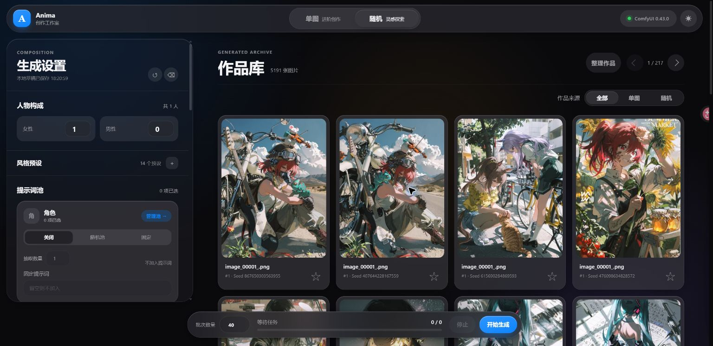
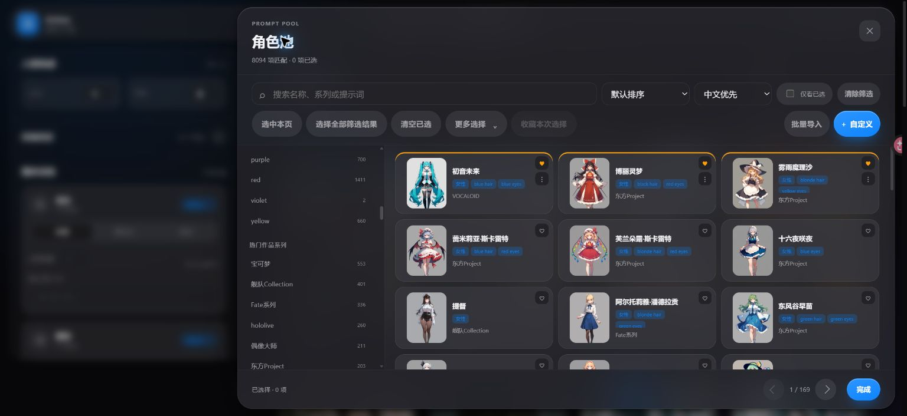
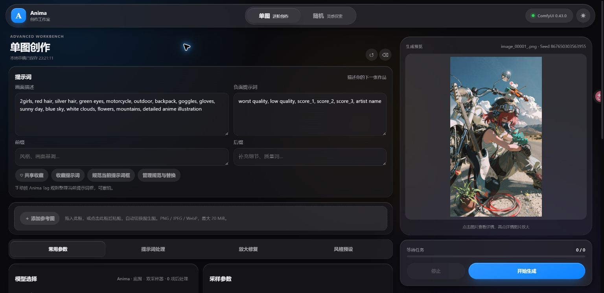

<p align="center">
  
</p>

<h1 align="center">Anima Random Studio</h1>

<p align="center">
  <strong>从随机抽卡，到单图创作。</strong><br>
  为 Anima 与 Krea 2 准备的 ComfyUI 本地生图工作台。
</p>

<p align="center">
  <a href="https://github.com/159159pzy-crypto/comfyui-random-image-generation/releases/tag/1.4.0"><strong>下载 Windows 版</strong></a> ·
  <a href="#开始使用">开始使用</a> ·
  <a href="docs/guide.md">使用指南</a> ·
  <a href="CHANGELOG.md">更新日志</a> ·
  <a href="https://qm.qq.com/q/M9MbjzaAUA">QQ 交流群</a>
</p>



<p align="center"><sub>真实工作台截图。模型、LoRA 与作品为本机示例，不包含在安装包中。</sub></p>

固定角色与风格，批量尝试新的动作和场景；遇到喜欢的结果，再送进单图工作台继续调整。Anima Random Studio 把这段创作过程接在一起，也把 ComfyUI 环境、模型下载和服务状态交给一个独立的 Windows 启动器管理。

> [!NOTE]
> 当前为 **1.4.0 beta**，需手动下载；**收藏功能暂不推荐使用**。完整从零安装、GPU 生图及升级回退实机验收仍未完成，使用前请阅读 [发行说明](RELEASE_NOTES.md)。

## 开始使用

1. **下载并打开启动器。** 在 [发布页](https://github.com/159159pzy-crypto/comfyui-random-image-generation/releases/tag/1.4.0) 下载 `AnimaRandomStudio.exe` 直接运行，或选择 `AnimaRandomStudio-Setup-win-x64.exe` 安装。
2. **准备 ComfyUI。** 已有可用环境就导入；也可跟随向导新建独立环境，检查所需下载与磁盘空间后开始安装。Krea 2、SeedVR2 和本地反推模型按需选取。
3. **生成第一张图。** 点击「开始创作」，选择已准备好的模型；先关闭可选放大与修复，用单图描述或随机词池完成一次基础生成。

启动器支持 **Windows 10 1809+ / Windows 11 x64**。新建完整环境面向 NVIDIA，需支持 CUDA 12.8 的驱动（570.65 或更新）。已有环境沿用原来的 Python 与 GPU 运行时。工作台默认访问 <http://127.0.0.1:8190>。

[安装方式与运行要求](docs/guide.md#准备环境) · [启动器完整说明](launcher/README.md) · [最新正式版](https://github.com/159159pzy-crypto/comfyui-random-image-generation/releases/latest)

## 随机的范围，由你决定

Anima 的角色、服装、姿势、背景、表情分成五个内容池。每一池都能关闭、随机或固定：可以全开找灵感，也可以只改变一个维度，逐步挑出更喜欢的组合。



<p align="center"><sub>浏览角色候选、按特征或作品系列筛选，把随机范围收在自己选定的内容里。</sub></p>

- **固定你想保留的内容。** 同一个角色换场景、同一套服装换动作，按自己的创作方向组合。
- **把自己的内容放进来。** 筛选候选、排除词条、自建分组，或通过 JSON / CSV 批量导入。
- **让探索连续进行。** 设置批次，追加队列，查看实际采样进度，再从作品库里挑选结果。

<details>
<summary>查看一个五池组合示例</summary>


</details>

[词池选择、全库模式与导入示例](docs/guide.md#词池与批量生成)

## 喜欢这一张，就从这里继续

随机工作台负责展开可能性，单图工作台负责具体调整。提示词正文、前后缀与负面词分开编辑，参考图可以选择、拖入或粘贴；模型、LoRA 与采样参数在旁边直接调整。



### 参数随作品一起留下

作品详情保存提示词、参数和种子。你可以载入设置继续编辑、保留提示词换种子、重抽指定的随机维度，或把作品当作图生图参考。历史复现会检查资源并使用保存的最终文本，不会重新调用 AI 重写。


<p align="center"><sub>从作品回到创作：查看生成信息，载入设置、原种子重跑，或保留提示词探索新结果。</sub></p>

同提示词变体使用文生图；图生图目前使用普通采样模式。相同参数与种子也不承诺跨模型、节点版本和硬件环境的逐像素一致。

[单图与参考图](docs/guide.md#单图与图生图) · [历史复现与变体](docs/guide.md#历史与重生成)

## 两种模型，两种表达习惯

| | Anima | Krea 2 |
| --- | --- | --- |
| 提示词 | 以 Tag 组织画面要素 | 用自然语言描述画面 |
| 随机内容 | 角色、服装、姿势、背景、表情五池 | 独立的自然语言描述池 |
| 配置 | 分别记住模型资源、参数与工作台草稿 | 分别记住模型资源、参数与工作台草稿 |

需要帮忙组织语言时，打开 **提示词重写台**：选择服务、模型和系统提示词，查看结果，再决定追加或替换。想从一张图开始，则在 **反推台** 读取元数据，或主动选择视觉 AI / 本地标签识别。

基础规范和元数据提取在本地执行。AI 重写与视觉反推使用你配置的服务，选择远端供应商时会发送相应文字或图片；点击普通生成不会自动请求重写。

[提示词重写与图像反推](docs/guide.md#提示词与图像反推)

## 环境准备，也有一个入口

Windows 启动器把安装与创作衔接起来：新建或导入 ComfyUI、检查资源、启动服务、打开工作台，都在同一个窗口完成。

- **模型按需准备。** Anima 基础包、可选的 Krea 2、SeedVR2 与本地反推模型统一管理，也可添加自己的兼容模型和 LoRA。
- **下载可以接着来。** 进度、速度和错误留在对应页面，支持暂停、继续与重试；重开后等待手动继续，完成后核验大小和 SHA-256。
- **软件与环境分别维护。** 更新启动器和内置工作台；ComfyUI 与已有节点通过环境维护页单独更新。

生图时可按需组合多 LoRA、普通或双采样、潜空间放大、脸部细化、SeedVR2，以及满足硬件条件的 N 卡放大与 DLSS。先跑通基础生成，再逐步增加处理环节。

[模型与后处理](docs/guide.md#模型与后处理) · [下载与恢复](docs/guide.md#下载恢复) · [升级与数据备份](docs/guide.md#备份与升级)

## 从源码运行

需要 **Python 3.11+** 和已准备好节点、模型的本机 ComfyUI。先启动 ComfyUI，再在本仓库根目录运行：

```powershell
python -m venv .venv
.\.venv\Scripts\python.exe -m pip install -e .
.\.venv\Scripts\python.exe run.py
```

打开 `http://127.0.0.1:8190`。自定义节点位置、端口与数据目录的设置见 [源码运行参数](docs/guide.md#源码运行)。开发与构建分别见 [贡献指南](CONTRIBUTING.md) 和 [启动器开发说明](launcher/README.md#开发与构建)。

## 文档与交流

- [使用指南](docs/guide.md)：词池导入、图生图、反推、历史操作、删除与清理、备份及常见问题。
- [发行说明](RELEASE_NOTES.md) / [更新日志](CHANGELOG.md)：当前版本的变化、限制与验证范围。
- [提交 Issue](https://github.com/159159pzy-crypto/comfyui-random-image-generation/issues) / [QQ 交流群](https://qm.qq.com/q/M9MbjzaAUA)：反馈时附上版本、操作步骤和错误信息，遮去密钥等私人内容。
- [安全与支持范围](SECURITY.md) / [依赖说明](docs/dependencies.md)：本机访问边界、第三方组件与已知限制。

作者目前是学生，项目仍在维护，更新节奏会受学业影响。后续计划探索 mos 模型支持，尚未实现。

感谢 [ComfyUI](https://github.com/Comfy-Org/ComfyUI)、Anima Tools 和各节点、模型作者。项目代码采用 [MIT License](LICENSE)，模型与第三方组件遵循各自许可。
