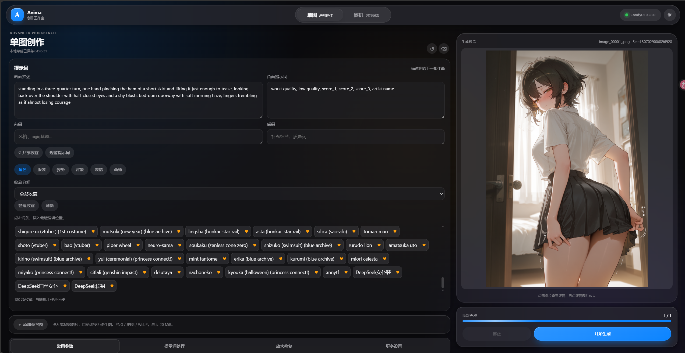
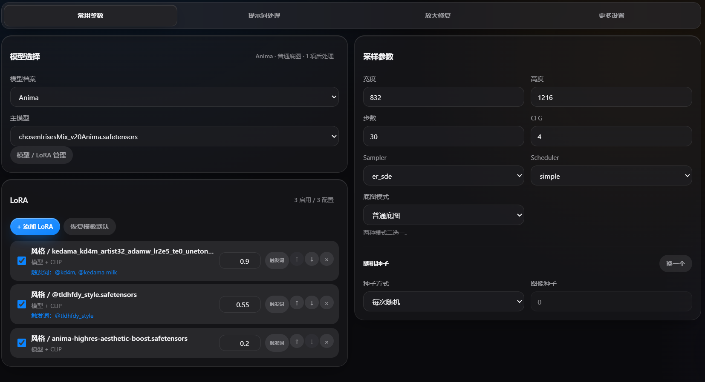
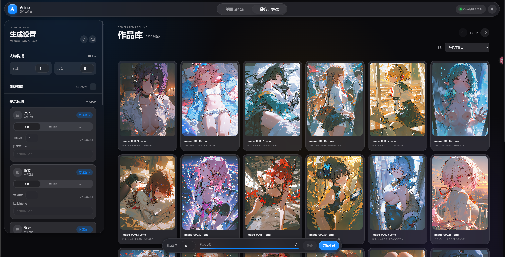

> [!WARNING]
> ## 🚧 测试版提醒：目前仍存在许多已知 BUG
>
> **如想用着不烧心，请等待后续版本更新。**

> **作者没跑路！** 作者目前是学生，更新频率可能较慢，但项目仍在维护中。遇到问题欢迎提交 [Issue](https://github.com/159159pzy-crypto/comfyui-random-image-generation/issues)。

# Anima Random Studio · 1.0.1

基于 [ComfyUI](https://github.com/Comfy-Org/ComfyUI) 的本地生图工作台，把单图创作、随机批量生成、模型与 LoRA 配置、提示词收藏和作品历史放在同一个界面中。支持 **Anima / Krea 2** 两套模型档案，并提供 Windows 启动器，用于安装环境、管理服务和更新工作台。

[下载与启动](#下载与启动windows) · [界面与功能](#界面与功能) · [自动安装与可选项](#启动器自动安装内容与可选项) · [升级与数据备份](#升级与数据备份) · [当前已知问题](#当前已知问题) · [升级计划](#升级计划)

**项目 QQ 群**：[点击加入交流群](https://qm.qq.com/q/M9MbjzaAUA)，欢迎交流使用体验、反馈问题。

## 1.0.1 更新介绍

本版整合了近期的工作台与启动器改版，重点完善从环境准备、参数配置到生成、查看和再次创作的使用流程。

- **单图 / 随机双工作台**：单图模式用于手动编写提示词、添加参考图和细调参数；随机模式用于组合词池、探索风格和批量生成。支持保存本地草稿，作品库可按工作台来源筛选。
- **模型档案与 LoRA 管理**：提供 Anima、Krea 2 档案，关联各自的模型资源、词池和风格配置；LoRA 支持添加、启停、调整权重与顺序，以及查看和编辑触发词。
- **生成流程扩展**：加入图生图、实时采样预览、普通底图与双采样配置，以及按需启用的放大和脸部修复。参数集中到分区面板，减少在不同位置来回查找。
- **随机结果与历史记录更一致**：随机池先在工作台解析出最终提示词，再交给 ComfyUI 执行，避免节点二次抽取造成实际角色与记录不一致。历史详情支持原参数复现、同提示词换种子及按指定内容重抽。
- **完整 Windows 启动器**：提供包含 EXE、DLL、.NET 和 Windows App Runtime 的完整 ZIP，解压后可直接运行根目录的 EXE。支持新建环境、导入已有 ComfyUI、安装预检、下载恢复、工作台升级与回退。
- **兼容性与稳定性修复**：兼容 Anima Tools 的标准目录名、`-main`、`-master` 和自定义目录名；对重复或不完整安装给出提示。同时修复快速重复提交、异步输入覆盖、资源刷新丢失参数、队列停止状态和历史回放等问题。

各版本的详细变化见 [更新日志](CHANGELOG.md)。当前已知问题与后续安排见本文末尾的[当前已知问题](#当前已知问题)和[升级计划](#升级计划)。

## 界面与功能

以下三张截图展示当前工作台。截图中的模型、LoRA、词条和参数为示例，实际可选内容取决于你的本地环境。

### 单图创作：从描述到细调

单图工作台适合已经有明确画面想法的创作：左侧编辑提示词和参数，右侧查看生成预览与进度。

- **分开编辑提示词**：画面描述、负面提示词、前缀和后缀各有独立输入区，便于保留常用风格和质量词。
- **提示词重写台**：在「提示词处理」中独立填写初始文本，选择服务、模型和系统提示词后主动重写。结果可编辑，再追加到或替换正向正文；前缀、后缀、负向词保持原样，并可撤销应用。Anima 与 Krea 2 分别记住重写草稿，点击生成不会自动运行重写。
- **共享收藏**：Anima 与 Krea 2 分别保存收藏；同一模型档案的单图与随机工作台共用条目和分组。Anima 保留五类内容及画师收藏，Krea 2 使用独立的自然语言收藏。
- **直接收藏提示词**：在提示词框中选中文字后点击「收藏提示词」；没有选区时保存最近编辑框的整段内容。可修改名称、正文和分组，Anima 还需选择内容分类。收藏只保存文本，不保存整套生成参数。
- **参考图输入**：支持选择文件、拖入或粘贴图片，添加后切换为图生图。支持 PNG / JPEG / WebP，单张最大 20 MiB，可调整降噪强度和尺寸适配方式。
- **图生图强度**：降噪越低越保留原图；不同模型对同一数值的重绘程度可能不同，潜空间二次采样等后处理还会继续改变画面。降噪为 0 时，基础阶段只做 VAE 编解码重建，后处理仍按配置执行。默认强度和已有草稿保持不变。
- **预览与继续创作**：查看采样进度和生成结果，点击图片打开详情及大图；历史作品可送到单图工作台继续编辑，也可用作图生图参考。

### 常用参数：模型、LoRA 与采样集中配置

常用参数面板把模型选择和 LoRA 列表放在一侧，把尺寸、采样与种子设置放在另一侧，方便逐项调整。

| 配置项 | 支持内容 |
| --- | --- |
| 模型档案 | Anima / Krea 2，按档案关联模型、文本编码器与 VAE 等资源 |
| LoRA | 多个 LoRA 组合、独立启停、权重调整、排序、移除及触发词管理 |
| 采样参数 | 宽高、步数、CFG、Sampler、Scheduler |
| 底图模式 | 普通底图、双采样；双采样可进一步配置切换步数及第二阶段参数 |
| 随机种子 | 每次随机或固定图像种子，便于探索变化或复用设置 |
| 放大与修复 | 按需配置潜空间放大、SeedVR2、脸部修复等处理，使用前需准备对应模型和节点 |

建议首次先用普通底图完成一次基础生成，再逐项启用放大或修复。未安装可选高清模型时，可以关闭对应功能使用基础生成。

单图与随机工作台分别保存 Anima / Krea 2 的参数草稿；首次进入使用对应默认值，再次切回恢复上次配置。已加载的模型和 LoRA 清单在当前页面内复用；新增文件或修改分类后，可在资源分类面板手动刷新，生成前仍会检查实际资源。

Krea 变化控制已从操作界面移除，后台参数、节点及插件依赖保持兼容。旧草稿和预设中的变化参数仍按原值执行，兼容设置的“恢复默认”不改动这组参数；历史详情仍显示当时使用的设置。

### 提示词规范与 AI 重写

Krea 2 的基础规范只整理首尾、行尾空白和换行编码，保留大小写、段落、专有名称、数字、标点、下划线与重复表达。Anima 继续使用 Tag 规则；两个档案的规则开关和自定义替换分别保存。Krea 2 的自定义替换匹配完整文本、区分大小写，不拆分逗号或句子。旧规则文件迁移至 Anima 前会保留 `.v1.bak` 备份。

单图点击「规范提示词」手动整理，随机工作台在编辑结束后自动整理。基础规范在本地完成，不调用 LLM。单图重写台的「读取当前提示词」只复制正向正文到初始输入，不会立即发起请求；AI 结果只有在点击追加或替换时才进入生图输入。

先启动 ComfyUI，再打开启动器「设置 → 提示词助手」管理供应商、模型与多套系统提示词。配置沿用 Prompt Assistant 插件，支持其 OpenAI 兼容服务和 Ollama；工作台刷新选项后即可选用。密钥继续由插件存储，不使用 Windows 凭据管理器；编辑时密钥框留空保留已有值，清除需要单独操作。

不新增默认系统提示词，也不暗加语言、扩写或翻译要求。任务使用所选模板的内容快照；缺少模板或纯模板兼容能力会明确报错。首次安装兼容补丁后需要重启 ComfyUI，安装与源码修复方法见[启动器说明](launcher/README.md)。

旧扩写与 OC 配置不再自动参与普通单图生成，已有处理结果作为重写台预览保留，应用前不会覆盖原正文。历史复现及同提示词变体继续使用保存的最终文本，不重新请求 AI。重写任务加入现有队列，支持取消；发送到 ComfyUI 后最多等待 300 秒。

### 随机工作台：组合词池，批量探索

随机工作台将生成设置、作品库和批次控制放在同一页面，适合固定部分内容、让其他内容随机变化。

- **五类内容池**：Anima 支持角色、服装、姿势、背景、表情五个维度，并可设置人物构成、画师与风格预设。
- **每个维度独立控制**：可选择「关闭」「随机池」或「固定」，组合固定提示词与随机候选。例如固定角色和服装，仅随机姿势与背景。
- **管理自己的词库**：支持筛选候选、排除不需要的内容、收藏分组、自定义词条，以及 JSON / CSV 批量导入。导入前先校验和预览，再处理冲突项。
- **Krea 2 独立词池**：使用独立的自然语言提示词池，支持新增和导入，避免与 Anima 的分维度词池混用。
- **批次与队列**：设置批次数量后连续生成；已有任务运行时可继续加入队列，并查看进度、管理等待任务或停止生成。进度区显示模型与提示词准备、等待首步、分段采样及解码等阶段；采样步数按 ComfyUI 实际回报更新，首步计算期间不会显示虚构百分比。状态查询超时会自动重试。
- **作品库**：按来源筛选、分页浏览作品，查看文件名、种子、提示词与生成参数，再从历史结果继续创作。

两个工作台的「共享收藏」均支持在最近编辑的提示词框中插入文本。随机工作台还可以将收藏选入对应词池；保存收藏本身不会自动勾选候选或开启词池。Anima 新收藏会创建或复用对应分类的自定义词条，已有「全选词库」仍遵循包含该分类全部词条的规则。

Krea 2 收藏保留保存时的文本，编辑或删除自然语言池词条不会改变收藏；再次「加入随机池」会复用同文本词条或重新创建。取消收藏不会删除词池条目。若出现「词条已保存，收藏待重试」，重试会复用原词条，避免重复创建。

### 历史复现与变体有什么区别

| 操作 | 会保留或改变什么 |
| --- | --- |
| 复现此图 | 使用历史保存的最终正负提示词、生成设置和原种子重跑；会先检查所需模型、LoRA 和采样资源 |
| 同提示词变体 | 保留最终提示词，换一个图像种子重新生成；这是文生图变体，不是图生图 |
| 重抽指定内容 | 针对随机工作台记录，选择角色、服装、姿势、背景或表情重新抽取，其余内容按历史快照保留 |
| 按此配置再抽 | 复用原配置，重新抽取随机内容与种子，继续生成同类作品 |

具体可用操作取决于该条历史记录保存的信息和当前资源检查结果。缺少历史所需资源时会明确提示，不会自动换成其他模型；相同参数与种子也不代表跨模型版本、节点版本或硬件环境的逐像素一致。

## 下载与启动（Windows）

### 1. 下载完整启动器

打开 [1.0.1 下载页](https://github.com/159159pzy-crypto/comfyui-random-image-generation/releases/tag/1.0.1)，下载 **`AnimaRandomStudio-win-x64-unsigned.zip`**。

**不要下载页面底部的 Source code 来找 EXE。** 那两份是开发源码；上面的 ZIP 才是完整启动器包。

### 2. 完整解压并运行

将 ZIP **完整解压到一个新文件夹**，直接双击解压后**根目录**的 **`AnimaRandomStudio.exe`**。保留同目录的 DLL、运行时和资源文件，不要只复制或替换 EXE。

启动器适用于 **Windows 10/11 x64**，已包含 .NET 与 Windows App Runtime。ComfyUI、节点和模型在首次配置时单独准备，不包含在启动器 ZIP 内。当前包未做代码签名，文件名中的 `unsigned` 即表示未签名；可使用附件 `SHA256SUMS.txt` 核对 ZIP 完整性。

### 3. 新建或导入环境

进入「安装环境」，按自己的情况选择：

| 方式 | 适合谁 | 操作要点 |
| --- | --- | --- |
| 新建环境 | 希望由启动器准备独立运行环境的用户 | 选择安装位置，先检查安装计划、下载内容和磁盘空间，再开始安装 |
| 导入已有 ComfyUI | 已有可正常运行的 ComfyUI 或便携版用户 | 选择 ComfyUI 目录或便携版父目录，检查识别到的 Python、节点与模型；特殊布局可手动指定 Python |

新建环境面向 NVIDIA 显卡，需要支持 CUDA 12.8 的驱动（570.65 或更新版本）和联网下载。已有其他显卡环境可尝试导入，兼容性取决于 ComfyUI 与所用节点。Anima 基础模型可由启动器准备，Krea 2、SeedVR2 等资源按模型资源页提示另行添加。

下载中断后可继续或重试，已校验的资源会复用。遇到模型校验失败时，按界面提示处理对应文件。

### 4. 启动工作台并生成第一张图

配置完成后回到「概览」，点击 **启动工作台**。默认 ComfyUI 端口为 `8188`，工作台端口为 `8190`；使用默认配置时可在浏览器打开 `http://127.0.0.1:8190`。

1. 进入「单图」，选择已经准备好资源的模型档案和主模型。
2. 填写画面描述，检查宽高、步数、CFG 和采样器。
3. 首次使用先关闭尚未配置的放大与修复功能，点击「开始生成」。
4. 基础生成成功后，再添加 LoRA、参考图或切换到随机工作台进行批量探索。

关闭启动器窗口会收起到托盘；需要退出时，可在托盘菜单选择保留服务退出，或停止本程序启动的服务后退出。

## 启动器自动安装内容与可选项

以下内容按 **1.0.1 的安装清单**说明。在「安装环境」完成检查并开始安装后，启动器才会执行环境准备；仅打开 EXE 不会立即下载整套环境。

### 新建环境会自动准备什么

| 内容 | 自动处理方式 |
| --- | --- |
| Python | 安装 Python **3.11.9**，为 ComfyUI 创建独立的 `.venv` 虚拟环境 |
| 安装工具 | 下载并校验 **uv**；优先复用系统中可用的 Git，没有可用 Git 时下载隔离的 **MinGit** |
| ComfyUI | 拉取安装清单锁定的 ComfyUI 提交，并安装其 Python 依赖 |
| GPU 运行依赖 | 安装 **PyTorch 2.11.0、torchvision 0.26.0、torchaudio 2.11.0** 的 **CUDA 12.8** 版本 |
| 自定义节点 | 安装下面列出的 10 个节点，并执行其依赖安装步骤 |
| 基础模型 | 默认准备 Anima 底模、Qwen 文本编码器和 Qwen VAE，已有可复用文件会先检查 |
| 安装验证 | 检查关键依赖、PyTorch 的 GPU 可用性与 Python 包依赖一致性 |

新建环境会在所选安装位置下建立同级的 `ComfyUI` 和 `runtime` 目录：前者存放 ComfyUI、虚拟环境、节点和默认模型，后者存放安装工具、Python、下载缓存及临时文件。NVIDIA 显卡驱动需要自行安装或更新，启动器安装的是 Python 环境中的 CUDA 版 PyTorch，不会代装显卡驱动。

**导入已有环境的处理不同**：复用现有 ComfyUI、Python 和 GPU 运行时，补齐清单中缺失的节点及其依赖；用户原有、未由启动器托管的节点会保留，不强行升级。导入流程不会自动下载整套基础模型，缺少的可下载模型可在「模型资源」中勾选后下载。

### 随环境安装的 10 个节点

| 节点 | 主要用途 |
| --- | --- |
| `Comfyui-Anima-Tools` | Anima 提示词池与相关工具 |
| `rgthree-comfy` | 工作流切换与辅助控制 |
| `comfyui-impact-pack` | 工作流条件判断及修复相关节点 |
| `comfyui-impact-subpack` | Impact 配套检测节点 |
| `comfyui-easy-use` | 表达式计算等工作流辅助功能 |
| `ComfyUI-KJNodes` | 图像尺寸调整、模型传递和显存辅助节点 |
| `ComfyUI-Lora-Manager` | LoRA 加载、触发词及模型元数据管理 |
| `comfyui-aaalice-nodes` | 提示词选择、分组控制与分辨率预设 |
| `prompt-assistant` | 提示词扩写相关节点；工作台的「提示词处理」目前仍不可用 |
| `krea-seed-variance-enhancer` | Krea 种子变化增强节点 |

这些节点按清单统一安装，不是安装向导中可逐项取消的选项。**安装了节点不等于已经下载对应的可选模型**；新建环境中的 ComfyUI 和节点版本按清单锁定，便于恢复安装。完整版本和来源见 [运行环境清单](launcher/manifests/launcher-manifest.json)。

### 默认自动下载的 Anima 基础模型

| 用途 | 文件名 | 默认目录（相对 ComfyUI） | 文件大小约 |
| --- | --- | --- | --- |
| Anima 底模 | `anima-base-v1.0.safetensors` | `models/diffusion_models` | 3.89 GiB |
| Qwen 文本编码器 | `qwen_3_06b_base.safetensors` | `models/text_encoders` | 1.11 GiB |
| 共享 VAE | `qwen_image_vae.safetensors` | `models/vae` | 242 MiB |

三项模型合计约 **5.24 GiB**，不包含 PyTorch、Python、节点依赖、缓存和解压空间；实际所需下载量与剩余磁盘空间以安装预检为准。自动下载文件会校验大小及 SHA-256。若配置了 `extra_model_paths.yaml`、多个模型目录或旧版 `unet` 路径，启动器会按 ComfyUI 实际路径扫描和定位资源。

### 可选模型与扩展资源

| 可选项 | 需要准备的文件 | 当前安装方式 |
| --- | --- | --- |
| Krea 2 | 底模 `krea2_turbo_int8_convrot.safetensors`、文本编码器 `qwen3vl_4b_fp8_scaled.safetensors`；复用上面的 Qwen VAE | **仅检测与手动导入**。在「模型资源」选择条目，通过「查看来源与授权」访问来源，再手动放入对应目录 |
| SeedVR2 修复放大 | 模型 `seedvr2_3b_int8_convrot.safetensors`、VAE `ema_vae_fp16.safetensors` | **仅检测与手动导入**，按资源页来源准备；还需具备所用工作流要求的节点 |
| 自选底模与 LoRA | 用户自行选择的兼容模型及 LoRA | 手动添加；LoRA 默认放在 `models/loras`，启动器会扫描本地资源，不会自动下载截图中的 LoRA |
| 其他放大、脸部检测或修复资源 | 以工作台所选功能的资源检查结果为准 | 当前自动下载清单不包含全部高级处理资源，需要按缺失提示另行准备 |

Krea 2 和 SeedVR2 在当前清单中没有启用可校验的自动下载，因此不能把它们当作首次安装时可勾选的一键下载包。手动添加时，底模放入有效的 `diffusion_models` 目录、文本编码器放入 `text_encoders`、VAE 放入 `vae`，随后重新扫描；运行中的 ComfyUI 可能需要重启才能刷新列表。由于当前启动器的底模文件夹入口存在问题，请使用文件资源管理器手动进入实际目录。

可自动下载的模型、文件名、来源和校验信息见 [模型清单](launcher/manifests/model-manifest.json)。

### 可以自行选择的安装与运行设置

- **安装方式与位置**：新建独立环境，或导入已有 ComfyUI / 便携版；新建时可选择存放环境、工具和缓存的磁盘。
- **下载来源**：提供官方来源、国内模型 / Python 镜像（Git 使用官方）、GitHub 镜像加国内模型 / Python 镜像，以及自定义来源。预设内容见 [下载来源清单](launcher/manifests/source-profiles.json)。
- **高级下载设置**：可指定 Git HTTPS 镜像模板、Hugging Face 镜像、Python 包索引，以及包含锁定提交的自定义 ComfyUI 仓库。设置仅用于本项目，不改写系统 Git / pip 配置。
- **导入环境的 Python**：默认自动识别 `.venv`、`venv` 和便携版 Python，识别失败时可手动指定解释器。
- **模型下载**：在「模型资源」中重新扫描，勾选支持自动下载且缺失的模型，再点击「下载所选模型」；也可使用「选择基础生成包」选择当前档案所需的可下载项。
- **运行设置**：可修改 ComfyUI / 工作台端口、界面主题，以及是否随启动器自动启动服务。

## 升级与数据备份

1. **先备份数据**：启动器的配置、日志和用户数据默认保存在 `%LOCALAPPDATA%/AnimaRandomStudio`，迁移前备份整个目录。旧源码版的数据位于原项目的 `data` 目录。
2. **新版解压到新目录**：退出旧启动器后运行新版 EXE，保留新版完整文件结构。
3. **应用新版工作台**：在设置中选择「应用内置新版」，等待当前生成与队列空闲后切换；需要时可回退上一工作台版本。

旧源码版的 `data` **不会自动迁入**启动器的数据位置。浏览器本地草稿与数据目录备份不同，更换浏览器或清除站点数据后不要依赖草稿恢复。

## 常见问题

**提示词池为空，或找不到 Anima Tools？**

确认节点已完整安装。标准目录、`-main`、`-master` 和改名目录均支持，不需要仅为去掉后缀重装；若提示重复目录或数据文件不完整，请先处理对应安装。

**模型或 LoRA 没有显示？**

在 ComfyUI 的 LoRA Manager 中完成扫描与基础模型分类，再回到工作台刷新分类。新增模型后可能需要重启 ComfyUI；同时检查所选模型档案是否与资源类型一致。

**生成失败，或提示缺少节点 / 模型？**

先关闭可选放大和修复，检查当前档案的基础模型与节点能否完成基础生成，再按日志补齐缺失项。模型文件存在并不代表对应节点已经安装。

**端口被占用，或启动器显示外部服务？**

检查已有 ComfyUI 和工作台是否仍在运行，确认环境与端口后按提示连接或修改配置；启动器不会随意停止不属于它的外部实例。

## 源码、反馈与许可

- 源码运行、环境说明和 Windows 构建步骤见 [启动器说明](launcher/README.md)。
- 历史版本变更见 [更新日志](CHANGELOG.md)，第三方依赖说明见 [依赖说明](docs/dependencies.md)。
- 报告问题请到 [Issues](https://github.com/159159pzy-crypto/comfyui-random-image-generation/issues)，附上版本、操作步骤和相关错误日志；贴日志前请遮去令牌等私密信息。

项目代码采用 [MIT License](LICENSE)，模型和第三方节点遵循各自许可。默认服务仅监听本机。

## 当前已知问题

> **目前暂时无法通过启动器中的「底模文件夹」入口打开对应文件夹。** 如需访问，请先使用 Windows 文件资源管理器手动进入实际模型目录。

## 升级计划

以下记录本轮修复进度及后续升级事项。

### 第 2 轮修复进度

- [x] 仅移除 Krea 变化控制操作界面，保留后台与旧配置行为。
- [x] 修复单图工作台模型档案切换的编码资源与参数恢复问题。
- [x] 修复单图工作台 LoRA 失效的问题，并通过实机启停对照验证。
- [x] 单图工作台收藏夹按 Krea 2 / Anima 模型档案隔离；支持直接在单图工作台收藏提示词，同一档案下与随机工作台的收藏互通。
- [x] 按模型档案缓存资源清单，单图 / 随机切换复用已加载数据。
- [ ] 优化或移除「减容设置」，并将旧版预设迁移为新版存储格式。
- [x] 修复生成预览进入下一步时旧阶段进度与图片响应造成的闪回。
- [x] 完成图生图参考图链路、LoRA 和后处理的实机对照与回归验证；未复现忽略参考图，保留现有强度。
- [x] 优化 Krea 2 提示词规范，按模型隔离规则并保留自然语言表达。

### 第 3 轮升级待办

- [x] 将单图提示词处理改为独立重写台，并支持在启动器中管理 LLM 供应商和自定义系统提示词。
- [ ] 将单图生成详情改为紧凑布局。
- [ ] 将「更多设置」改为「风格预设」。
- [ ] 新增提示词反推工作台。
- [ ] 优化性能，检测并修复 Bug，完善项目。
