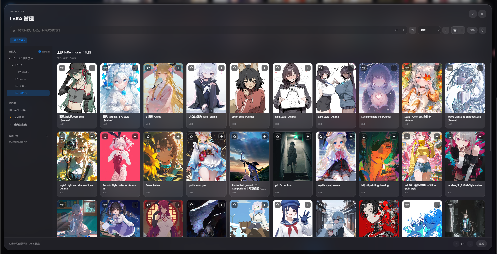

# Comfy Image Atelier 1.6.2 — 稳定性修复与 LoRA 管理

发布日期：**2026-11-07**。

本版集中修复 **软件更新、预设与词池导入、历史回放及生成结果恢复**。从最新公开版 1.5.1 升级，还将获得 1.6.0 引入的完整 LoRA 管理、人物绑定、触发词同步与 v4 放大修复流程。

## 本次修复

- **软件更新与空闲停机。** 修复 Windows 虚拟环境的 Python 启动进程与实际监听进程不同导致的失败，兼容已有启动器记录；正常退出不再误报进程身份变化，保留进程归属校验与退出后的端口检查。
- **预设与词池导入。** 保存风格预设时切换模型档案，不再造成预设列表串档案或参数误写；更换导入文件、关闭重开弹窗、切换词池或档案后，旧预览与迟到响应不会覆盖当前操作。
- **历史变体与复现。** 单图历史变体保留请求的 1–100 张数量；复现和同提示词变体使用保存的最终提示词，删除原 Krea 词池条目不再阻止回放。必要的模型、LoRA 和参考图仍须可用。
- **生成结果恢复。** 已提交任务在结果查询短暂断连时，按原任务 ID 有界重试，不重复提交生成；重试耗尽会记录结果未确认及任务 ID，保留已完成图片并继续后续任务。停止和关闭可中断等待。
- **LoRA 查询与保存。** 单项和封面查询复用清单索引并按资源变化刷新缓存；触发词写盘失败时不发布未保存内容。人物绑定统一从 LoRA 详情的「选择人物」进入，已有绑定仍可编辑。

## 从 1.5.1 升级：LoRA 管理与人物绑定

从原有快速添加弹窗展开完整管理区，把本地 LoRA 的浏览、资料整理、收藏、批量操作和人物绑定放到同一个工作区。

截图摄于 1.6.0，模型与作品为本机使用示例，安装包不包含这些 LoRA 和预览资源。

- **从快速添加展开完整资料库。** 保留原快速添加入口，点击右上角展开图标进入管理区。目录导航支持多个模型根目录，图库与列表可切换，搜索覆盖名称、路径、标签和触发词，筛选与排序即时生效。
- **按自己的方式整理模型。** 星标、多层收藏分组、标签与备注集中管理；详情先阅读、需要时再编辑，统一保存触发词覆盖、默认权重等资料。星标、标签和备注与 LoRA Manager 共用。
- **跨页选择与批量操作。** 批量加入或移出当前生成配置、收藏、归组、修改标签和绑定人物，提供进度、逐项结果、取消与失败重试。移出当前配置后同步整理自动触发词。
- **Anima 人物自动带上 LoRA。** 每个人物可绑定多个 LoRA，也能把一个 LoRA 批量绑定到多个人物。随机抽到人物后逐张启用，手动配置优先，同一文件只加载一次；重复追加保留已有顺序、权重与启停状态。
- **触发词自动同步到单图前缀。** 添加或启用 LoRA 后补入缺少的触发词，跨前缀、正文和后缀去重；停用、移除和编辑时同步维护自动词，保留手写内容。自动词归属随草稿、预设和历史保存。
- **历史记录保留实际配置。** 人物绑定与触发词在任务入队时固定，历史及 PNG 保存实际生效的结果；复现使用当时的 LoRA 和提示词，重抽人物使用当前绑定。失效绑定跳过并记录原因，复现缺少必要资源时明确提示。

管理区沿用工作台明暗主题与玻璃材质，支持窄屏分层返回、键盘和系统辅助设置；修复展开／收起结束时内容跳位与详情间距问题。

人物自动绑定适用于 **Anima 随机人物池**，不从自由文本推断角色，也不应用于 Krea 2 或单图工作台。LoRA 文件移动、重命名、删除、在线更新和封面替换仍在原插件中完成。详见 [LoRA 管理与人物绑定指南](https://github.com/159159pzy-crypto/comfy-Image-Atelier/blob/1.6.2/docs/guide.md#lora-管理与人物绑定)。

## 同步更新：v4 放大修复流程

- 新任务使用 **底图 → 像素高清 → 潜空间放大及采样 → 整图后采样 → 脸部细化 → SeedVR2 → N 卡 VSR → DLSS → 保存** 的流程，工作台显示本次启用阶段。
- 潜空间缩放与采样、整图后采样分别配置；两者同时开启执行两段重绘，VSR 与 DLSS 也可独立启用。Anima 与 Krea 2 分别保存参数。
- 只开启像素高清时，默认缩至模型原生输出的 50%；开启整图后采样时跳过这次缩图，使用原生输出尺寸，可能增加显存和耗时。
- 修复固定种子时采样被 ComfyUI 缓存跳过的问题，每张新版任务从底图开始完整执行所选流程，保留种子与模型加载缓存。
- v2/v3 历史继续按原链路复现；载入旧设置创建新任务时提示升级到 v4，不改写原历史。

## 下载与升级

- **推荐安装版**：`AnimaRandomStudio-Setup-win-x64.exe`，支持覆盖已有安装。
- **单文件版**：`AnimaRandomStudio.exe`，直接运行；`AnimaRandomStudio-portable-win-x64.zip` 仅包含同一份 EXE。
- `SHA256SUMS.txt` 用于校验三个程序附件，`build-info.json` 记录版本、来源提交和载荷哈希。GitHub 的 Source code 附件为开发源码。
- 保留原 EXE 文件名、安装标识和用户数据目录。升级前等待队列空闲、退出启动器并备份数据；旧仓库版本需从新仓库手动下载安装一次。
- 软件升级不会自动升级已有 ComfyUI 或节点，已有环境可从「安装环境」检查和修复缺失依赖。LoRA 管理依赖当前环境的 LoRA Manager 与已扫描资源。

## 验证范围

本地发布准备仅运行版本、发行内容、静态规则和语法检查。GitHub 标签发布沿用现有自动流程，执行 Python 与前端回归、Chromium 集成测试、依赖审计，以及 Windows 启动器构建、包体完整性和隔离安装／修复／卸载测试；全部通过后才公开附件，运行结果可在 [GitHub Actions](https://github.com/159159pzy-crypto/comfy-Image-Atelier/actions/workflows/launcher.yml) 查看。

本次打包发布未重新进行完整新机冷安装或 GPU 生图实测；1.5.1 的硬件与安装验收属于历史记录，不作为 1.6.2 的实测结论。

[完整更新日志](https://github.com/159159pzy-crypto/comfy-Image-Atelier/blob/1.6.2/CHANGELOG.md) · [使用指南](https://github.com/159159pzy-crypto/comfy-Image-Atelier/blob/1.6.2/docs/guide.md) · [启动器说明](https://github.com/159159pzy-crypto/comfy-Image-Atelier/blob/1.6.2/launcher/README.md)
