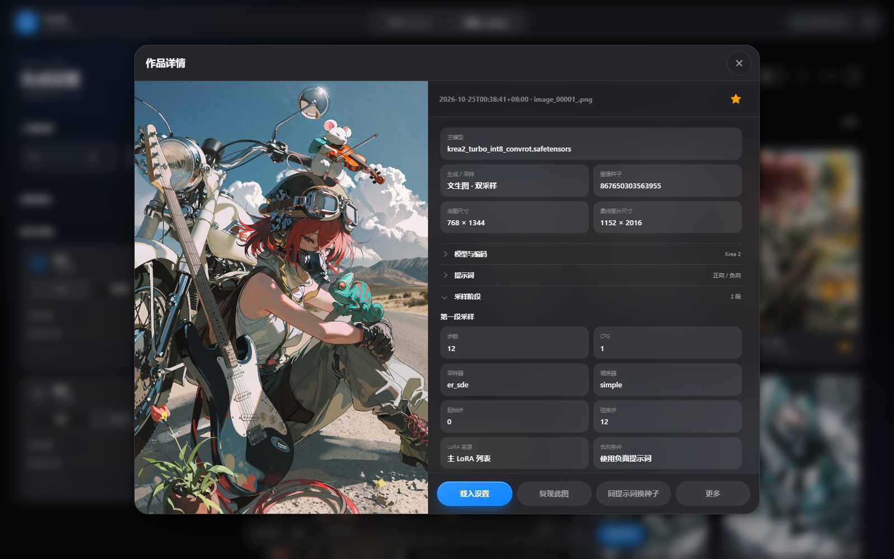

# 使用指南

本指南介绍 Anima Random Studio 的词池、提示词处理、生成参数、作品查看与数据维护。初次使用可先阅读 [项目首页](../README.md)，环境安装与启动器维护的详细步骤见 [启动器说明](../launcher/README.md)。

当前 **1.4.0 为 beta 预发布版**，需手动下载，不进入正式版自动更新渠道；完整实机验证尚未完成，范围见 [发行说明](../RELEASE_NOTES.md)。**收藏功能当前不推荐使用**，本版仅保留相关入口。

[准备环境](#准备环境) · [单图与图生图](#单图与图生图) · [词池与批量生成](#词池与批量生成) · [提示词与图像反推](#提示词与图像反推) · [模型与后处理](#模型与后处理) · [历史与重生成](#历史与重生成) · [作品查看与删除](#作品查看与删除) · [下载恢复](#下载恢复) · [备份与升级](#备份与升级) · [常见问题](#常见问题)

## 准备环境

### 运行要求

| 项目 | 要求与说明 |
| --- | --- |
| Windows 启动器 | Windows 10 1809 及以上 / Windows 11，x64 |
| 新建完整环境 | NVIDIA 显卡，驱动支持 CUDA 12.8，版本 570.65 或更新；需要联网下载 |
| 导入已有环境 | 已可正常运行的 ComfyUI 或便携版；复用现有 Python 与 GPU 运行时，其他显卡的兼容性取决于 ComfyUI 与所用节点 |
| 磁盘空间 | Anima 三项基础模型约 5.24 GiB，另需环境、依赖和缓存空间；以安装预检为准 |
| 源码运行 | Python 3.11+，另行准备可用的本机 ComfyUI、节点与模型 |

仅打开启动器不会立即下载整套环境。首次未配置环境时进入安装向导，选择新建或导入，确认目录，再检查下载内容、可复用资源和空间，检查通过后开始准备。提示词助手配置可以跳过，稍后在设置中补充。

### 新建与导入的区别

**新建环境**准备独立 Python、ComfyUI、清单节点与 Anima 基础模型；Krea 2、SeedVR2 和本地反推模型按需选择，默认不勾选。新建环境使用 Python 3.11.9 与独立 `.venv`，准备 CUDA 12.8 版 PyTorch 及安装工具。显卡驱动需要自行安装或更新。

检查阶段解析 ComfyUI 正式版与节点默认分支提交，并保存安装计划，后续重试继续该计划。已有节点更新在环境维护页手动执行。

**导入已有环境**时，选择 ComfyUI 目录或便携版父目录，启动器自动识别 Python，也可手动指定。导入保留已有节点版本和 GPU 运行时，补齐缺失依赖；不会整套自动下载基础模型，可到模型资源页按需准备。

清单涉及 Anima Tools、rgthree、Impact Pack / Subpack、Easy Use、KJNodes、LoRA Manager、aaalice nodes、Prompt Assistant、WD Timm Tagger 和 Krea 种子增强。具体仓库与安装规则见 [运行清单](../launcher/manifests/launcher-manifest.json) 和 [启动器说明](../launcher/README.md)。

### 模型文件与目录

以下目录相对 ComfyUI，实际路径也可能由有效的额外模型配置指定。

| 用途 | 模型文件 | 默认目录 |
| --- | --- | --- |
| Anima 底模 | `anima-base-v1.0.safetensors` | `models/diffusion_models` |
| Anima 文本编码器 | `qwen_3_06b_base.safetensors` | `models/text_encoders` |
| 共享 VAE | `qwen_image_vae.safetensors` | `models/vae` |
| Krea 2 底模，可选 | `krea2_turbo_int8_convrot.safetensors` | `models/diffusion_models` |
| Krea 2 文本编码器，可选 | `qwen3vl_4b_fp8_scaled.safetensors` | `models/text_encoders` |
| SeedVR2，可选 | `seedvr2_3b_int8_convrot.safetensors`、`ema_vae_fp16.safetensors` | 按模型资源页提示准备 |
| 自选 LoRA | 兼容当前档案的 LoRA 文件 | `models/loras`，支持有效的额外模型路径 |

本地反推提供 PixAI、WD、OppaiOracle 共八个预设模型包，推荐 `pixai-tagger-v0.9-timm`，按需下载。其他高级放大、检测及修复资源不一定在自动下载范围内，请以生成前检查结果为准。

安装节点与准备模型是两件事。文件来源、版本、大小、SHA-256 与许可见 [模型清单](../launcher/manifests/model-manifest.json)。新增模型后重新扫描资源，必要时重启 ComfyUI。

### 打开工作台

向导完成后点击「开始创作」，或在概览点击「启动工作台」。默认地址：

- Studio：<http://127.0.0.1:8190>
- ComfyUI：<http://127.0.0.1:8188>

先选择已准备好的模型档案，关闭可选放大与修复，完成一次基础生成，再逐项增加 LoRA 与后处理。

## 单图与图生图

单图工作台每次生成一张。正向正文、负面提示词、前缀和后缀分别编辑，可将常用风格词与本次画面描述分开维护。生成期间可查看大图预览与进度，完成后打开详情或查看完整原图。

单图与随机工作台、Anima 与 Krea 2 分别保存参数草稿，切回时恢复对应配置。两种工作台均可通过风格预设保存和应用参数组合。

### 添加参考图

可以选择文件、拖入参考图识别框，或聚焦框后粘贴图片。添加后切换为图生图，可调整降噪强度与尺寸适配方式。反推台使用独立的识别框，框外拖放不会上传图片或切换生图模式。

- 支持单帧 PNG / JPEG / WebP，单张不超过 20 MiB、4000 万像素。
- 图生图仅支持普通采样模式。
- 降噪越低，通常越接近参考图；不同模型对同一数值的响应可能不同。
- 降噪为 0 时，基础阶段执行 VAE 编解码重建，已开启的后处理仍会改变画面。

历史作品可送回单图工作台继续编辑，也可用作图生图参考。具体操作取决于记录保存的信息及当前资源状态。

## 词池与批量生成

### Anima 五类内容池

Anima 将角色、服装、姿势、背景、表情分别成池，每个池可切换「关闭」「随机池」「固定」，再搭配人物构成、画师与风格设置。

| 组合方式 | 用途 |
| --- | --- |
| 固定角色和服装，随机姿势与背景 | 探索同一角色的动作和场景 |
| 固定背景和姿势，随机角色 | 在相近条件下观察人物与画风变化 |
| 只开放一个随机维度 | 缩小变化范围，逐项挑选组合 |
| 五池全开 | 探索新的内容搭配 |

词池支持搜索筛选、候选选择、排除项、自定义词条与 JSON / CSV 批量导入。导入前可预览、校验，并处理重复或冲突条目。

选择操作分别作用于不同范围：

- **选中本页**：选择当前页条目。
- **选择全部筛选结果**：跨页追加当前筛选结果，同时保留筛选范围外的已有选择。
- **清空已选**：清除已有选择。
- **更多选择 → 使用整个词库**：Anima 全库模式忽略筛选，包含全库及以后新增的词条，同时允许逐项排除。

### Krea 2 自然语言池

Krea 2 的词池独立保存，每条内容包含名称、补充说明和提示词正文，支持搜索、自定义分组树，以及带预览和冲突处理的 JSON / CSV 导入。

两个模型档案分别管理词池与相关配置。Anima 使用 Tag 规则；Krea 2 保留自然语言的段落、大小写与标点，不把整段描述拆成标签。

JSON 导入示例：

```json
{
  "version": 1,
  "items": [
    {
      "section": "prompt",
      "title": "雨夜街景",
      "subtitle": "霓虹灯下的城市夜景",
      "prompt": "A rain-soaked city street illuminated by neon lights.",
      "groups": ["城市", "夜景"]
    }
  ]
}
```

CSV 使用 `section,title,subtitle,prompt,groups` 列，多个分组用 `|` 分隔，含逗号或换行的正文按 CSV 规则加引号：

```csv
section,title,subtitle,prompt,groups
prompt,雨夜街景,霓虹灯下的城市夜景,A rain-soaked city street illuminated by neon lights.,城市|夜景
```

同正文条目默认跳过，覆盖只更新名称、说明和分组。

### 批次、队列与种子

设置批次数量后自动接续生成，运行期间可以继续加入任务、管理等待项或停止当前任务。进度区区分模型与提示词准备、等待首步、采样及解码，采样步数以 ComfyUI 实际回报为准。

随机工作台底栏显示批次与任务进度，单图工作台提供大图实时预览。固定图像种子时，随机工作台仍会逐张抽取提示词；图像种子与词池抽样的作用不同。

停止操作优先使用 ComfyUI 的定向取消接口。旧版不支持时，只移除本任务等待项，已经开始的生成可能仍需在 ComfyUI 中手动停止。

## 提示词与图像反推

### 基础规范与 AI 重写

基础规范在本地整理标签或文本格式，可应用自定义替换规则，不调用 AI。两个模型档案采用各自的规范方式。

单图工作台的提示词重写台提供独立输入区。选择服务、模型和系统提示词后主动请求重写，结果可编辑、复制，再追加或替换到正向正文；应用操作可撤销。点击生成不会自动执行重写。

启动 ComfyUI 后，在启动器「设置 → 提示词助手」管理供应商、文本 / 视觉模型和系统提示词。支持 Prompt Assistant 提供的 OpenAI 兼容服务与 Ollama；工作台刷新选项后即可使用。重写与视觉 AI 按模型档案输出 Anima 英文标签或 Krea 2 英文自然语言。

### 三种图像反推方式

| 方式 | 行为 | 需要准备 |
| --- | --- | --- |
| 元数据提取 | 读取图片已有提示词和可识别的生成信息 | 受支持的内嵌元数据，无需模型在线 |
| 视觉 AI | 使用视觉模型描述画面，结果可编辑 | Prompt Assistant 与支持图像输入的视觉模型 |
| 本地标签 | 使用本地 Tagger 识别画面标签 | WDTimmTagger 节点与完整模型包 |

拖入反推图片时，默认只读元数据。没有可用提示词时，由你选择视觉 AI 或本地标签并开始识别。模型识别生成画面描述，不会编造原始负向词、种子或采样参数；提取到的参数也不会自动覆盖当前生图设置。

元数据、模型识别结果与生成设置的来源不同，使用前可分别查看和编辑。插件兼容补丁、本地模型准备与故障处理见 [提示词助手说明](../launcher/README.md#提示词助手) 和 [本地图像反推模型](../launcher/README.md#本地图像反推模型)。

### 服务与数据去向

生图由本机 ComfyUI 执行。AI 重写和视觉反推将输入发送给所选服务；选择远端供应商时，相关文字或图片会离开本机。供应商密钥由 Prompt Assistant 插件管理。访问范围和数据注意事项见 [安全说明](../SECURITY.md)。

## 模型与后处理

| 配置 | 支持内容 |
| --- | --- |
| 模型档案 | Anima / Krea 2，关联各自的底模、文本编码器与 VAE 等资源 |
| LoRA | 多 LoRA 组合、独立启停、权重、排序与触发词管理，结合 LoRA Manager 读取本地资源 |
| 底图与采样 | 宽高、步数、CFG、采样器、调度器，以及固定或随机种子 |
| 底图模式 | 普通底图与双采样分别保存编辑配置，图生图只使用普通采样 |
| 潜空间放大 | 缩放与二次采样参数；Sesqui 模型格式支持 1–2 倍 |
| 后处理 | 脸部细化、SeedVR2、N 卡放大与 DLSS，依赖对应节点、模型和硬件 |
| 风格预设 | 在单图与随机工作台保存、应用参数组合，按模型档案区分 |

执行顺序为 **底图 → 潜空间放大 → 脸部细化 → SeedVR2 → N 卡放大及 DLSS**，各后处理模块可关闭。建议先完成基础生成，再逐项尝试后处理，方便确认每项效果与资源要求。

Krea 2 提供默认关闭的「K2 多样性增强」。各模型档案与工作台保存独立草稿；旧配置中的兼容参数继续保留。所选采样器或调度器缺失时会提示，不会自动换成其他值。

## 历史与重生成

作品库可按「全部 / 单图 / 随机」筛选，详情显示提示词、种子与生成参数。可查看完整原图、缩放及拖动，也可在本机 Windows 中定位原图文件。



### 四种重生成操作

| 操作 | 保留内容 | 变化范围 |
| --- | --- | --- |
| 复现此图 | 历史最终正负提示词、设置和原双种子 | 按保存的信息重新执行 |
| 同提示词变体 | 最终提示词、生成设置与原生成模式；图生图保留原参考图 | 更换图像种子 |
| 重抽指定内容 | 可可靠恢复的其他历史内容 | 重抽指定随机维度，如姿势或背景 |
| 按此配置再抽 | 历史配置与词池设置 | 重新抽取随机内容与种子 |

可用操作取决于记录保存的信息和当前资源。「重抽指定内容」仅针对历史中原本开启随机的维度，改变的是提示词选择。它不能保证画面中其他像素或构图完全不变。

历史复现与同提示词变体直接使用保存的最终文本，不重新请求 AI 重写。复现前会检查所需模型、LoRA 和采样资源，缺失时明确提示，不会自动替换模型。

**相同参数与种子不承诺跨模型、节点版本或硬件环境的逐像素一致**。后处理流程更新也可能影响旧图的重跑结果。

「载入设置」与立即重生成不同：它将历史配置送回工作台供后续编辑；当前生成数量和完整卡池配置按现有载入规则保留，单图仍每次生成一张。

## 作品查看与删除

历史列表支持按「全部 / 单图 / 随机」筛选来源和分页浏览。点击图片可查看详情、放大全尺寸预览，或继续载入设置、复现与生成变体。

### 删除单张作品

在作品详情的「更多」中选择「删除作品」，确认界面默认只删除记录，也可选择连同原文件删除：

| 方式 | 处理结果 |
| --- | --- |
| 只删除记录 | 清除作品记录与相关缩略图，保留 ComfyUI 原图 |
| 删除记录及原文件 | 永久删除原图，不进入回收站，再完成记录删除 |

原文件操作仅用于经过核实的本机 Windows ComfyUI。仍被其他作品引用的文件受到保护；删除失败时会显示原因，可重试。删除输出原图不会顺带删除图生图导入的参考图。

### 导入图片的保存

图生图和反推导入的图片副本保存在本地，不再按闲置天数自动清理，也不提供手动清理入口。已有导入副本、历史作品和反推结果继续保留；旧版本保存的清理设置不再生效。

## 下载恢复

模型条目直接显示下载进度、速度与错误，可分别暂停、继续或重试。安装和更新页面显示各自任务，完整列表从「查看全部下载」进入。

启动器内嵌 aria2 与 uv，保存下载状态和断点：

- **暂停**：停止下载，保留可继续的状态。
- **继续或重试**：检查任务与文件状态后接续处理。
- **取消任务**：保留已下载文件；清理未完成文件是另一项操作。
- **重新打开启动器**：恢复任务列表，等待手动继续，不自动恢复下载。
- **下载完成**：仍需检查大小及 SHA-256，多文件模型包全部校验后才就绪。

下载来源见 [来源清单](../launcher/manifests/source-profiles.json)，换源、网络配置和断点规则见 [启动器下载说明](../launcher/README.md#下载暂停与恢复)。

关闭窗口会收起到托盘，服务与下载可继续运行。真正退出时，可以保留服务，或停止本启动器创建的服务后退出；启动器不会随意结束外部服务。

## 备份与升级

### 备份哪些内容

| 内容 | 保存位置与备份方式 |
| --- | --- |
| 启动器配置、历史与工作台数据 | 默认 `%LOCALAPPDATA%/AnimaRandomStudio`，备份整个目录 |
| 源码版数据 | 默认项目 `data`，或 `--data-dir` 指定的目录 |
| ComfyUI 原图、模型与插件配置 | 在对应 ComfyUI 环境中，按需单独备份 |
| 浏览器草稿 | 浏览器站点数据；更换浏览器或清除站点数据前另行保存重要内容 |

备份前先等待队列空闲、停止工作台并退出启动器。不要只复制运行中的数据库主文件，相关数据库状态可能分散在多个文件中。

安装版和单文件版共用用户数据。移动 EXE 不会迁移环境或历史，旧源码版 `data` 不会自动迁入启动器目录。安装版卸载保留用户数据、模型和环境。

### 软件与环境分开更新

启动器默认每 24 小时检查正式 Release，可在设置中关闭或手动检查。下载软件更新不打断生图，应用前需等待任务空闲；1.4.0 beta 需从发布页手动下载。

软件更新不会自动升级已有 ComfyUI 或节点，两者在环境维护页单独管理。更新失败时可恢复原版本与配置，工作台也提供「应用内置新版」和「回退上一版」。条件与操作见 [升级与数据](../launcher/README.md#升级与数据)。

## 源码运行

先为本机 ComfyUI 配好必要节点与模型并启动服务，再在本仓库根目录执行：

```powershell
python -m venv .venv
.\.venv\Scripts\python.exe -m pip install -e .
.\.venv\Scripts\python.exe run.py
```

默认打开 `http://127.0.0.1:8190`。使用其他端口或节点目录时，按自己的布局添加参数：

```powershell
.\.venv\Scripts\python.exe run.py --comfy-url http://127.0.0.1:8188 --anima-tools-dir '..\ComfyUI\custom_nodes\Comfyui-Anima-Tools' --data-dir '.\data'
```

示例节点目录需替换成实际路径。工作台与 ComfyUI 连接仅支持本机回环地址，默认面向本机单用户，详见 [安全说明](../SECURITY.md)。

将 [界面工作流](../templates/workflow_ui_v2.json) 拖入 ComfyUI 可检查缺失节点，应用实际使用 [API 工作流](../templates/workflow_api_v2.json)。开发检查与打包流程见 [贡献指南](../CONTRIBUTING.md) 和 [启动器开发说明](../launcher/README.md#开发与构建)。

## 常见问题

### 词池为空，或找不到 Anima Tools

检查节点是否完整安装，必要时用 `--anima-tools-dir` 指定目录。标准目录、`-main`、`-master` 和自定义目录名均可识别，不必只为去掉后缀重装。重复目录或数据文件缺失时按提示处理。

### 模型或 LoRA 没有显示

检查文件是否放入当前环境的有效模型目录，并在 LoRA Manager 中完成扫描与基础模型分类，再刷新工作台资源。新增文件后可能需要重启 ComfyUI，同时确认 Anima / Krea 2 档案匹配。

### 缺少节点、模型或采样资源，生成失败

先关闭可选放大与修复，确认基础生成可用，再按错误信息补齐。节点已安装不代表模型已下载，文件在磁盘上也不代表当前 ComfyUI 已经识别，可从启动器查看日志与资源状态。

### 端口被占用，或显示外部服务

确认是否已有 ComfyUI 或工作台进程在运行，核对环境与端口，再按提示连接或修改配置。启动器不会自动结束不属于它的外部实例。

### 如何报告问题

到 [Issues](https://github.com/159159pzy-crypto/comfyui-random-image-generation/issues) 提供版本、操作步骤和相关错误日志，提交前遮去供应商密钥、令牌及私人内容。第三方依赖限制见 [依赖说明](dependencies.md)。
