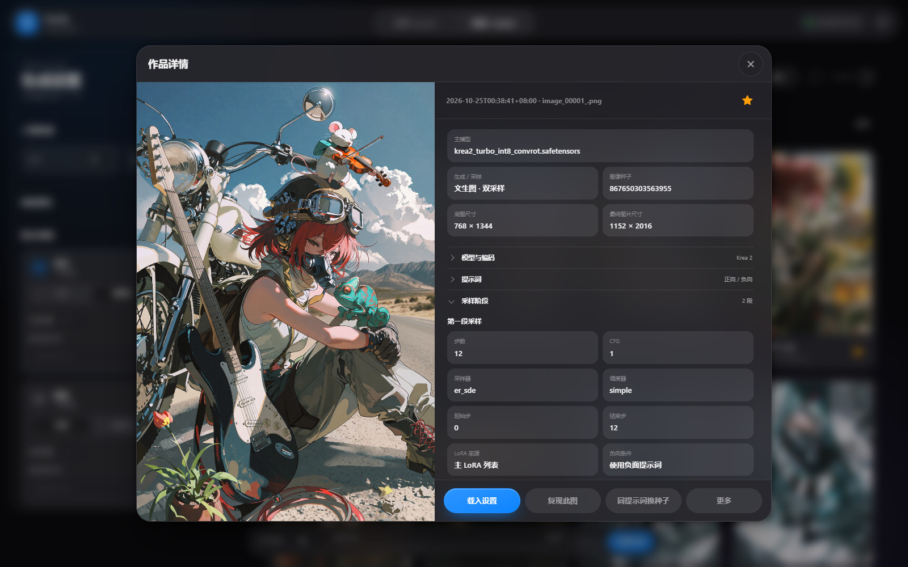

# 使用指南

本指南介绍 Comfy Image Atelier 的词池、提示词处理、生成参数、作品查看与数据维护。初次使用可先阅读 [项目首页](../README.md)，环境安装与启动器维护的详细步骤见 [启动器说明](../launcher/README.md)。

当前版本为 **Comfy Image Atelier 1.6.0 正式版**。软件由 Anima Random Studio 更名并迁移至新仓库；旧版用户请手动下载安装本版一次，后续正式版更新由新仓库提供。原 EXE 文件名、安装标识及数据目录保持兼容，本文适用于当前发行版。验证范围见 [发行说明](../RELEASE_NOTES.md)。

[准备环境](#准备环境) · [单图与图生图](#单图与图生图) · [词池与批量生成](#词池与批量生成) · [提示词与图像反推](#提示词与图像反推) · [模型与后处理](#模型与后处理) · [历史与重生成](#历史与重生成) · [作品查看与删除](#作品查看与删除) · [下载恢复](#下载恢复) · [备份与升级](#备份与升级) · [常见问题](#常见问题)

## 准备环境

### 运行要求

| 项目 | 要求与说明 |
| --- | --- |
| Windows 启动器 | Windows 10 1809 及以上 / Windows 11，x64 |
| 新建完整环境 | NVIDIA 显卡，驱动支持 CUDA 12.8，版本 570.65 或更新；需要联网下载 |
| 导入已有环境 | 已可正常运行的 ComfyUI 或便携版；复用现有 Python 与 GPU 运行时，其他显卡的兼容性取决于 ComfyUI 与所用节点 |
| 磁盘空间 | Anima 三项基础模型约 5.24 GiB，另需环境、依赖和缓存空间；以安装预检为准 |
| 源码运行 | Python 3.11+，另行准备可用的本机 ComfyUI、节点与模型 |

仅打开启动器不会立即下载整套环境。首次未配置环境时进入安装向导，选择新建或导入，确认目录，再检查下载内容、可复用资源和空间，检查通过后开始准备。提示词助手配置可以跳过，稍后在设置中补充。

### 新建与导入的区别

**新建环境**准备独立 Python、ComfyUI、清单节点与 Anima 基础模型；Krea 2、SeedVR2 和本地反推模型按需选择，默认不勾选。新建环境使用 Python 3.11.9 与独立 `.venv`，准备 CUDA 12.8 版 PyTorch 及安装工具。显卡驱动需要自行安装或更新。

检查阶段解析 ComfyUI 正式版与节点默认分支提交，并保存安装计划，后续重试继续该计划。已有节点更新在环境维护页手动执行。

**导入已有环境**时，选择 ComfyUI 目录或便携版父目录，启动器自动识别 Python，也可手动指定。导入保留已有节点版本和 GPU 运行时，补齐缺失依赖；不会整套自动下载基础模型，可到模型资源页按需准备。

清单涉及 Anima Tools、rgthree、Impact Pack / Subpack、Easy Use、KJNodes、LoRA Manager、aaalice nodes、Prompt Assistant、WD Timm Tagger 和 Krea 种子增强。具体仓库与安装规则见 [运行清单](../launcher/manifests/launcher-manifest.json) 和 [启动器说明](../launcher/README.md)。

### 模型文件与目录

以下目录相对 ComfyUI，实际路径也可能由有效的额外模型配置指定。

| 用途 | 模型文件 | 默认目录 |
| --- | --- | --- |
| Anima 底模 | `anima-base-v1.0.safetensors` | `models/diffusion_models` |
| Anima 文本编码器 | `qwen_3_06b_base.safetensors` | `models/text_encoders` |
| 共享 VAE | `qwen_image_vae.safetensors` | `models/vae` |
| Krea 2 底模，可选 | `krea2_turbo_int8_convrot.safetensors` | `models/diffusion_models` |
| Krea 2 文本编码器，可选 | `qwen3vl_4b_fp8_scaled.safetensors` | `models/text_encoders` |
| SeedVR2，可选 | `seedvr2_3b_int8_convrot.safetensors`、`ema_vae_fp16.safetensors` | 按模型资源页提示准备 |
| 自选 LoRA | 兼容当前档案的 LoRA 文件 | `models/loras`，支持有效的额外模型路径 |

本地反推提供 PixAI、WD、OppaiOracle 共八个预设模型包，推荐 `pixai-tagger-v0.9-timm`，按需下载。其他高级放大、检测及修复资源不一定在自动下载范围内，请以生成前检查结果为准。

安装节点与准备模型是两件事。文件来源、版本、大小、SHA-256 与许可见 [模型清单](../launcher/manifests/model-manifest.json)。新增模型后重新扫描资源，必要时重启 ComfyUI。

### 打开工作台

向导完成后点击「开始创作」，或在概览点击「启动工作台」。默认地址：

- Studio：<http://127.0.0.1:8190>
- ComfyUI：<http://127.0.0.1:8188>

先选择已准备好的模型档案，关闭可选放大与修复，完成一次基础生成，再逐项增加 LoRA 与后处理。

## 单图与图生图

单图工作台每次生成一张。正向正文、负面提示词、前缀和后缀分别编辑，可将常用风格词与本次画面描述分开维护。生成期间可查看大图预览与进度，完成后打开详情或查看完整原图。

单图与随机工作台、Anima 与 Krea 2 分别保存参数草稿，切回时恢复对应配置。两种工作台均可通过风格预设保存和应用参数组合。

### 添加参考图

可以选择文件、拖入参考图识别框，或聚焦框后粘贴图片。添加后切换为图生图，可调整降噪强度与尺寸适配方式。反推台使用独立的识别框，框外拖放不会上传图片或切换生图模式。

- 支持单帧 PNG / JPEG / WebP，单张不超过 20 MiB、4000 万像素。
- 图生图仅支持普通采样模式。
- 降噪越低，通常越接近参考图；不同模型对同一数值的响应可能不同。
- 降噪为 0 时，基础阶段执行 VAE 编解码重建，已开启的后处理仍会改变画面。

历史作品可送回单图工作台继续编辑，也可用作图生图参考。具体操作取决于记录保存的信息及当前资源状态。

## 词池与批量生成

### Anima 五类内容池

Anima 将角色、服装、姿势、背景、表情分别成池，每个池可切换「关闭」「随机池」「固定」，再搭配人物构成、画师与风格设置。

固定提示词支持 Enter 换行，输入框随内容向下展开，最多显示六行，超过后在框内滚动。切到「随机池」或「关闭」时会缩回一行并保留文本，切回「固定」后重新展开。离开输入框时仍自动按 Anima Tag 规则整理，手动换行会转为逗号；可以使用「撤销上次规范」恢复上次整理前的内容。五池模式滑块和输入框伸缩均支持连续切换，系统启用减少动态效果时直接完成位置与高度调整。

| 组合方式 | 用途 |
| --- | --- |
| 固定角色和服装，随机姿势与背景 | 探索同一角色的动作和场景 |
| 固定背景和姿势，随机角色 | 在相近条件下观察人物与画风变化 |
| 只开放一个随机维度 | 缩小变化范围，逐项挑选组合 |
| 五池全开 | 探索新的内容搭配 |

词池支持搜索筛选、候选选择、排除项、自定义词条与 JSON / CSV 批量导入。导入前可预览、校验，并处理重复或冲突条目。

更换文件、切换词池或模型档案、关闭重开导入弹窗后，需要重新完成预览才能提交。预览完成后可继续修改目标分组名；点击导入时确定本次文件、处理方式和目标分组，随后切换页面不会改变已提交的内容。

选择操作分别作用于不同范围：

- **选中本页**：选择当前页条目。
- **选择全部筛选结果**：跨页追加当前筛选结果，同时保留筛选范围外的已有选择。
- **清空已选**：清除已有选择。
- **更多选择 → 使用整个词库**：Anima 全库模式忽略筛选，包含全库及以后新增的词条，同时允许逐项排除。

### 自定义角色的触发词与特征

内置角色使用 Anima Tools 提供的触发词和特征。自定义角色导入或编辑时在本地逐项识别，触发词可以有多个、位于任意位置；不会把第一项或未知词直接当作触发词。识别只读取 Anima Tools 词库、已安装的 PixAI 标签表和条目的名称、副标题、作品信息，不调用大模型，也不下载模型。

导入预览及编辑器显示「触发词」「特征」「待确认」和识别依据。完整匹配的已知角色、作品与普通特征可直接分类；词库冲突、未知词及只能靠括号变体推测的词需确认。点击标签调整归属，保留原文拼写和转义；可查看三种模式的输出。若原创角色只有描述，没有独立触发词，可明确确认这一点，「仅触发词」模式下该角色不贡献文本。

待确认的导入行需完成分类后选择导入或覆盖，也可跳过，其他行仍能正常导入。已经保存的待确认角色可以继续使用「触发词 + 特征」；另外两种模式在提交前检查当前有效候选池，并列出待处理角色，不会自动排除或替换随机候选项。

旧 JSON/CSV 的单段 `prompt` 格式继续支持；新模板可明确填写 `trigger` 与 `tags`。JSON 使用文本数组，CSV 使用带引号的逗号分隔单元格。提供完整 `prompt` 时，结构化内容必须与其相符；不自动补写元数据中的角色或作品名。导入内容只作为词条数据处理。

「触发词 + 特征」保留完整标签及顺序；「仅触发词」按原顺序保留触发词；「剔除服装」只删除归为特征且命中服装词表的标签。所有触发词、配饰、身体特征及不确定的衣物描述保持，暂不解析加权服装标签。固定文本、独立服装池、额外提示词与 LoRA 自动触发词沿用原处理。

已有自定义词库升级 v5 前会备份，保留原始提示词、角色 ID、分组和收藏。人工分类保存后不会因刷新、重启或词库更新而自动重分；重新识别保留仍与原文一致的人工分类。历史复现及保留历史角色的重抽继续使用当时保存的有效提示词。

### Krea 2 自然语言池

Krea 2 的词池独立保存，每条内容包含名称、补充说明和提示词正文，支持搜索、自定义分组树，以及带预览和冲突处理的 JSON / CSV 导入。

两个模型档案分别管理词池与相关配置。Anima 使用 Tag 规则；Krea 2 保留自然语言的段落、大小写与标点，不把整段描述拆成标签。

JSON 导入示例：

```json
{
  "version": 1,
  "items": [
    {
      "section": "prompt",
      "title": "雨夜街景",
      "subtitle": "霓虹灯下的城市夜景",
      "prompt": "A rain-soaked city street illuminated by neon lights.",
      "groups": ["城市", "夜景"]
    }
  ]
}
```

CSV 使用 `section,title,subtitle,prompt,groups` 列，多个分组用 `|` 分隔，含逗号或换行的正文按 CSV 规则加引号：

```csv
section,title,subtitle,prompt,groups
prompt,雨夜街景,霓虹灯下的城市夜景,A rain-soaked city street illuminated by neon lights.,城市|夜景
```

同正文条目默认跳过，覆盖只更新名称、说明和分组。

### 批次、队列与种子

设置批次数量后自动接续生成，运行期间可以继续加入任务、管理等待项或停止当前任务。进度区区分模型与提示词准备、等待首步、采样及解码，采样步数以 ComfyUI 实际回报为准。

随机工作台底栏显示批次与任务进度，单图工作台提供大图实时预览。固定图像种子时，随机工作台仍会逐张抽取提示词；图像种子与词池抽样的作用不同。

停止操作优先使用 ComfyUI 的定向取消接口。旧版不支持时，只移除本任务等待项，已经开始的生成可能仍需在 ComfyUI 中手动停止。

手动停止生图且取消已确认后，只有工作台与 ComfyUI 队列均空闲，才执行与正常生成相同的显存缓存清理和 Python 垃圾回收，保留模型加载、提示词编码和执行结果缓存。处理中暂时不能开始新任务；界面的「清缓存与垃圾回收已完成」表示 ComfyUI 已确认清理结束，不表示显存归零。保留后续任务、其他客户端仍有任务或取消尚未确认时，会跳过清理并说明原因；清理失败不改变任务的停止结果。正常完成仍按下述阶段清理，移除等待任务、取消提示词处理和关闭工作台不额外触发停止清理。

停止清理由随包 ComfyUI 扩展执行，固定调用 `soft_empty_cache()` 与 `gc.collect()`，不卸载模型、不清空执行结果缓存，也不新增清理开关。若提示清理扩展不可用，请通过启动器更新随包扩展并重启 ComfyUI；不会回退到全局卸载。

已成功提交的任务遇到结果查询断连、超时或 HTTP 502 / 503 / 504 时，会按原任务 ID 最多重试 5 次，间隔为 1、2、4、8、8 秒；每次连续故障从首次失败起最多恢复 60 秒。恢复期间可停止任务，断连时间不计入「任务不存在」的等待时间。执行错误、其他 HTTP 错误或无效响应直接报错。

恢复成功后继续接收原任务结果，不重复发送生成请求。重试耗尽会记录「结果未确认」及任务 ID，保留本批已完成的图片并继续后续任务；原任务可能仍在 ComfyUI 中执行，可用记录的 ID 核查。

## 提示词与图像反推

### 基础规范与 AI 重写

基础规范在本地整理标签或文本格式，可应用自定义替换规则，不调用 AI。两个模型档案采用各自的规范方式。

单图工作台的提示词重写台提供独立输入区。选择服务、模型和系统提示词后主动请求重写，结果可编辑、复制，再追加或替换到正向正文；应用操作可撤销。点击生成不会自动执行重写。

启动 ComfyUI 后，在启动器「设置 → 提示词助手」管理供应商、文本 / 视觉模型和系统提示词。支持 Prompt Assistant 提供的 OpenAI 兼容服务与 Ollama；工作台刷新选项后即可使用。重写与视觉 AI 按模型档案输出 Anima 英文标签或 Krea 2 英文自然语言。

### 三种图像反推方式

| 方式 | 行为 | 需要准备 |
| --- | --- | --- |
| 元数据提取 | 读取图片已有提示词和可识别的生成信息 | 受支持的内嵌元数据，无需模型在线 |
| 视觉 AI | 使用视觉模型描述画面，结果可编辑 | Prompt Assistant 与支持图像输入的视觉模型 |
| 本地标签 | 使用本地 Tagger 识别画面标签 | WDTimmTagger 节点与完整模型包 |

拖入反推图片时，默认自动读取元数据。无论是否提取到提示词，都可以选择视觉 AI 或本地标签，点击「开始识别」运行所选模型。三种方式的结果分别保留，切换或刷新页面后可继续查看和编辑。模型识别生成画面描述，不会编造原始负向词、种子或采样参数；提取到的参数也不会自动覆盖当前生图设置。

元数据、模型识别结果与生成设置的来源不同，使用前可分别查看和编辑。插件兼容补丁、本地模型准备与故障处理见 [提示词助手说明](../launcher/README.md#提示词助手) 和 [本地图像反推模型](../launcher/README.md#本地图像反推模型)。

### 服务与数据去向

生图由本机 ComfyUI 执行。AI 重写和视觉反推将输入发送给所选服务；选择远端供应商时，相关文字或图片会离开本机。供应商密钥由 Prompt Assistant 插件管理。访问范围和数据注意事项见 [安全说明](../SECURITY.md)。

## 模型与后处理

| 配置 | 支持内容 |
| --- | --- |
| 模型档案 | Anima / Krea 2，关联各自的底模、文本编码器与 VAE 等资源 |
| LoRA | 多 LoRA 组合、独立启停、权重、排序与触发词管理，结合 LoRA Manager 读取本地资源 |
| 底图与采样 | 宽高、步数、CFG、采样器、调度器，以及固定或随机种子 |
| 底图模式 | 普通底图与双采样分别保存编辑配置，图生图只使用普通采样 |
| 像素高清 | 模型原生放大后按百分比缩图，默认 50% / Lanczos；整图后采样开启时跳过缩图 |
| 潜空间放大 | 缩放后独立采样，可设置倍率、算法、步数、CFG、采样器、调度器与降噪；Sesqui 另显示模型格式 |
| 整图后采样 | 独立开关与采样参数，继承底图最终采样阶段的模型、LoRA、正负条件及图像种子 |
| 后处理 | N 卡 VSR、SeedVR2、脸部细化与 DLSS，各自开关，依赖对应节点、模型和硬件 |
| 风格预设 | 在单图与随机工作台保存、应用参数组合，按模型档案区分 |

预设始终归属于创建时的模型档案。保存过程中切换档案不会改变其归属；收藏和改名保留原模型与 CLIP 设置，覆盖参数需在同一档案中操作。需要另一档案的预设时，请切换档案后新建。

「管理风格预设」提供紧凑卡片和列表两种视图，选择会保存在当前浏览器中，两种模型档案共用。搜索支持名称、标签、模型资源和 LoRA；切换视图不会清空筛选或已选项目。点击条目进入编辑，点击「应用」使用参数，编辑返回后保持原来的浏览位置。

首页新收藏的预设在保存成功后排到最前，取消收藏后回到原有基础排序中的位置，再次收藏会重新置顶。收藏操作不改变预设的内容更新时间；实际编辑后仍按更新时间调整基础位置，刷新或重启后保留排序。

管理页默认按「最近更新」排序，也可选择「最近创建」或「名称」；收藏和取消收藏只改变星标，不移动条目。在「已收藏」或收藏分组筛选中，取消收藏成功后条目会移出当前筛选。点击星标立即显示新状态，保存失败会恢复星标并显示原因；后台刷新提示显示在结果栏，不挤动卡片和滚动区域。

新建和编辑的标签可以用回车、中英文逗号或多行粘贴分隔，通过标签旁的移除按钮删除；保存时会一并收录输入框中的最后一个标签。批量标签同样支持这种输入方式，「追加」「移除」「替换全部」仍按原有规则处理。加入收藏分组会同步收藏，移出分组保留星标，删除分组不会删除预设。

封面支持 PNG、JPEG、WebP，裁切比例为 4:3。上传后可拖动、使用方向键调整位置，并通过滑块缩放。保存失败保留草稿；关闭有未保存修改的窗口会先询问。界面支持系统的减少动态效果、减少透明度和高对比度偏好。

v4 执行顺序为 **底图 → 像素高清 → 潜空间放大及采样 → 整图后采样 → 脸部细化 → SeedVR2 → N 卡 VSR → DLSS → 保存**。各阶段独立开关；潜空间开启即缩放并采样，再开启整图后采样会执行第二段重绘。整图后采样可单独开启，DLSS 也可单独开启。

开关只设置下一次任务包含的阶段。点击「开始生成」时冻结配置，每张图从底图采样开始，完整执行所选阶段并保存；相同提示词、种子和参数也重新计算。模型加载、提示词编码和参考图预处理可复用缓存，任务不会自动使用上一次成图作为输入。放大修复区末尾的「流程」显示当前启用顺序，继承关系和旧设置迁移说明可展开查看。

v3–v5 流程会在底图和每个已启用的后处理阶段结束后自动清理显存缓存并执行 Python 垃圾回收，最终阶段的清理在保存前执行；没有额外设置开关。该机制采用 ComfyUI-KJNodes 的 `VRAM_Debug`，固定启用 `empty_cache` 和 `gc_collect`，关闭 `unload_all_models`。它保留模型加载、提示词编码与执行结果缓存，不删除图像、历史记录或磁盘缓存，也不改变图像种子和采样参数。v2 历史链路保持原有行为。

若生成前提示 `VRAM_Debug` 不可用，请在 ComfyUI 环境中安装或更新 ComfyUI-KJNodes，然后重启 ComfyUI 并刷新工作台资源。清理依次跟随实际图像数据执行，可能增加少量耗时；仍被使用的数据和模型继续占用显存，因此不应以显存是否归零判断清理是否执行。

像素高清和整图后采样默认关闭。高清模型按实际原生倍率运行：例如原生 4 倍后缩至 50%，得到约底图 2 倍。开启后采样会完全跳过高清缩图，使用原生尺寸进入后续阶段；如果还开启 VSR、SeedVR2 或潜空间放大，尺寸会继续变化。程序不会为避免显存不足而静默修改倍率或降噪。

潜空间采样和整图后采样分别保存参数，默认均使用 `er_sde / simple`：Anima 为 16 步、CFG 4、降噪 0.2；Krea 2 为 10 步、CFG 1、降噪 0.3。两段都继承底图最终采样阶段的模型、LoRA、正负条件及种子。仅开启潜空间采样不会跳过高清缩图。

潜空间关闭后参数全部隐藏，重新开启保留原值。Sesqui 支持 1–2 倍，当前 Anima/Krea 2 默认使用 Wan 2.1 格式；其他算法支持实际节点声明的范围，旧 bilinear 等选择保持原值。v2/v3 历史重生成保留原版本链路；载入旧设置创建新任务时保留既有开关和参数，按档案初始化新增潜空间采样并提示升级，不改写原记录。

Krea 2 提供默认关闭的「K2 多样性增强」。各模型档案与工作台保存独立草稿；旧配置中的兼容参数继续保留。所选采样器或调度器缺失时会提示，不会自动换成其他值。

单图和随机工作台均在底图控制的「是否 K2 多样性增强」下方提供「负向条件零化」，默认关闭。开启后将编码后的负向条件置零，保留负面提示词文本；旧单图配置实际使用副管线时，其独立零化开关显示在主开关下方。普通底图和双采样都使用这一布局，开关值随草稿、预设和历史保存。

## LoRA 管理与人物绑定

「添加 LoRA」保留原快速添加界面，点击右上角的小型展开图标进入完整管理区。可按文件夹、收藏组和标签浏览，切换图库或列表，并查看放大预览和模型详情。展开与收起保留搜索、各自滚动位置、分页和选择状态。默认显示当前模型档案的资源；切换全部可整理其他资源，但只有兼容当前档案且已被 ComfyUI 识别的 LoRA 可以加入生成。

完整管理区点击卡片查看详情，卡片上的加号用于加入当前配置；加入后该位置变为减号，可直接移出。详情与批量栏也提供「移出当前配置」。移出会同步主界面并整理自动触发词，离线、缺失或不兼容的已配置项也能移出；收藏、人物绑定和磁盘文件保留。若人物仍绑定该 LoRA，抽到人物时仍可能自动启用，需要停用自动关系时请编辑人物绑定。

目录树来自全部已扫描的 LoRA 库存，不随当前模型档案、关键词或其他筛选消失；目录旁数量表示当前模型档案中的资源数，切换档案后更新，没有匹配资源的目录仍保留并显示 0。结果区数量表示所有已生效筛选的匹配数。同名相对目录在不同模型根目录下分别显示。没有模型文件的空目录不会出现，父级目录由已扫描路径补齐。

搜索支持名称、文件路径、标签和有效触发词。点击筛选图标，在浮层中组合模型档案、标签包含与排除、已添加、人物绑定及预览状态；条件修改立即生效，上方条件标签可单独移除，Esc 只关闭浮层。排序在顶部独立设置。进入选择模式后可选择当前页或全部筛选结果，再批量加入／移出当前配置、收藏、归组、修改标签或绑定人物；批量任务会分别报告成功、失败与取消，支持重试失败项。

详情默认展示资料，点击「编辑」再修改标签、备注、默认权重、收藏分组和触发词，最后统一保存或取消。保存部分失败会保留未完成内容，重试不重复提交已完成的步骤。离开尚未保存的编辑时，可选择保存并离开、放弃或继续编辑。

星标与 LoRA Manager 共用，标签和备注也写入插件元数据；多层收藏组保存在工作台。一个 LoRA 可以属于多个组，父组包含子组的成员。取消星标后退出收藏视图，但保留归组记录，再次收藏时恢复；删除收藏组不会删除模型文件或取消星标。插件离线时显示缓存状态，不能把离线状态当作保存成功。

点击星标立即显示新状态，保存期间仅暂停该项重复收藏，其他条目仍可操作。保存失败会恢复原状态并显示原因；插件已保存但回读尚未确认时，显示待完成状态。收藏视图中的条目会在取消收藏保存成功后移出。

管理页按模型档案、搜索、筛选和分页复用 30 秒内的查询结果。超过 30 秒再打开或切回窗口时，先显示已有结果再后台同步；外部插件修改后，也可以点击现有刷新按钮立即读取最新数据，无需等待缓存到期。刷新失败保留列表并暂停写入，生成时的资源校验仍独立执行。

若插件已保存而本地保存或回读失败，详情会显示待完成步骤；在当前服务会话内重试只完成剩余步骤，不重复写插件。此类临时恢复记录不跨服务重启，重启后请刷新核对插件资料，并重新确认尚未保存的本地分组或默认权重。正常保存的分组、权重和人物绑定会在重启后恢复。

使用 `Ctrl K` 聚焦搜索，方向键浏览卡片与目录，`Esc` 逐层返回详情、抽屉和弹窗。界面会跟随系统的减少动态效果、减少透明度与高对比度偏好。

详情中的触发词是工作台按模型档案保存的覆盖，可恢复插件原值；覆盖为空表示不自动添加触发词。默认权重只影响之后加入的 LoRA，不修改已有生成配置或人物绑定。文件移动、重命名、删除、在线下载更新和封面替换仍通过原插件管理。

单图工作台添加或启用 LoRA 时，会检查前缀、画面描述和后缀，将缺少的触发词自动补到前缀。禁用、移出或修改触发词时，仅清理自动加入且已不再需要的词，保留手写内容与其他 LoRA 共用的词。自动词记录随草稿、预设和历史保存；旧记录没有自动词标记时保留原文字。随机工作台继续将触发词写入额外提示词。

### Anima 人物池绑定

从 LoRA 详情的「选择人物」建立关联，点击详情中的已绑定人物可编辑关联。每个人物可以绑定多个 LoRA，分别设置权重、启停和顺序。绑定使用人物稳定 ID，改名不影响；删除人物或移动模型文件后保留失联记录供重新关联，不按同名资源自动替换。

LoRA 详情的「选择人物」复用原人物池的分类树、收藏视图、搜索、筛选、语言切换和分页，并允许一次选择多位人物。这里的选择仅用于本次绑定，取消不保存，确认也不改变原生成随机池；已绑定人物会标明状态。人物词库的新建、编辑、导入和删除仍在原人物池管理入口进行。

批量绑定采用追加规则：同一 LoRA 可追加到多个人物，多个 LoRA 也可追加到同一人物。已有关系保持原顺序、权重、启停状态与文件身份；只有缺少的关系加入末尾，重复提交不会覆盖原设置。新关系使用提交时确认的权重，未指定时冻结当时的默认权重，之后修改默认权重不会改变已提交任务。

向多个人物追加时，每个人物分别记录成功或失败；已存在的关系计为跳过并视为成功。取消只停止尚未开始的目标，已经开始的写入会完成；失败重试只处理失败人物，并继续使用原任务的权重。需要修改已有绑定时，请进入该人物的绑定编辑界面。

随机工作台每张抽到人物后，按人物顺序启用其有效绑定。手动配置优先：同一文件采用手动权重，手动关闭也会阻止自动开启；多人绑定同一文件时只加载一次，采用第一个人物的权重。缺失、不兼容或超过 64 项容量的自动绑定会跳过，原因显示在任务进度和图片详情；手动资源失效、服务断开仍按正常生成错误处理。

绑定规则及有效触发词在入队时固定，之后编辑只影响新提交任务；模型文件可用性仍在每张提交前检查。自动 LoRA 与触发词只作用于本张，不写回共享草稿。该能力仅适用于 Anima 人物池，不从自由文本猜角色，也不应用于 Krea 2 自然语言池或单图工作台。

历史和 PNG 保存最终有效 LoRA、原手动配置、人物来源与跳过原因。复现和同提示词变体使用当时实际生效的配置；必要历史资源缺失时会阻止复现。内容重抽保留人物时保留原绑定，重抽人物时采用新人物的当前绑定；按原设置重抽使用当前绑定。旧历史没有绑定快照时，将已保存 LoRA 视为手动配置。

## 历史与重生成

作品库可按「全部 / 单图 / 随机」筛选，详情显示提示词、种子与生成参数。可查看完整原图、缩放及拖动，也可在本机 Windows 中定位原图文件。



### 四种重生成操作

| 操作 | 保留内容 | 变化范围 |
| --- | --- | --- |
| 复现此图 | 历史最终正负提示词、设置和原双种子 | 按保存的信息重新执行 |
| 同提示词变体 | 最终提示词、生成设置与原生成模式；图生图保留原参考图 | 更换图像种子 |
| 重抽指定内容 | 可可靠恢复的其他历史内容 | 重抽指定随机维度，如姿势或背景 |
| 按此配置再抽 | 历史配置与词池设置 | 重新抽取随机内容与种子 |

可用操作取决于记录保存的信息和当前资源。「重抽指定内容」仅针对历史中原本开启随机的维度，改变的是提示词选择。它不能保证画面中其他像素或构图完全不变。

历史复现与同提示词变体直接使用保存的最终文本，不重新请求 AI 重写，也不依赖原词池条目仍然存在。重新抽取内容时仍需所选词池条目可用。所需模型、LoRA、参考图和采样资源缺失时明确提示，不会自动替换模型。

普通单图生成与「复现此图」每次生成一张。历史变体按输入的数量生成，范围为 1–100 张；排队后保持提交时的数量，各张结果分别保存历史和图片元数据。

**相同参数与种子不承诺跨模型、节点版本或硬件环境的逐像素一致**。后处理流程更新也可能影响旧图的重跑结果。

「载入设置」与立即重生成不同：它将历史配置送回工作台供后续编辑；当前生成数量和完整卡池配置按现有载入规则保留，单图仍每次生成一张。

## 作品查看与删除

历史列表支持按「全部 / 单图 / 随机」筛选来源和分页浏览。点击图片可查看详情、放大全尺寸预览，或继续载入设置、复现与生成变体。

作品库优先加载屏幕内的缩略图，并提前加载附近图片。临时加载失败时会显示自动重试状态，最多自动再试 3 次；每次失败后的等待约为 0.3、0.8、1.5 秒，并略微错开。滚动到不可见处、隐藏图库或切到后台时暂停新的重试，重新可见后继续；已加载成功的图片保持显示。自动重试耗尽后点击「重试」，即可立即开始新一轮，无需刷新整页。

### 收藏作品

卡片右下角和详情信息栏右侧的星星共用收藏状态，适用于单图和随机作品。点星星展开收藏夹菜单，再点收藏夹立即加入或移出；菜单保持打开，可以继续选择其他夹。没有收藏夹时可直接新建并收藏。实心星表示至少属于一个夹，不代表只属于当前夹。

作品来源在标题行。下一行的「收藏夹」可向侧边展开已有收藏夹，点击某个夹后下方展示其中的作品；「全部作品」返回普通作品库。来源筛选与收藏夹筛选同时生效。收藏夹按最近收藏排序；重复加入不会改变顺序，移出后重新加入才会排到前面。

点击右侧「选择」后逐张勾选，可跨页、跨来源累积，工具栏显示已选总数及当前不可见数量；不提供全选。上方收藏夹入口此时用于选择目标夹，勾选一个或多个后点击「收入收藏夹」一次保存。成功后退出选择并保留浏览位置，失败后保留选择供重试。收藏夹内还可使用「移出当前收藏夹」，不会影响原图或其他归属。清空、取消、刷新页面或切换工作台会结束或清除当前选择。

收藏夹管理图标打开小浮层，可新建、重命名、拖动排序，或使用键盘排序控件。名称为 1–80 个字符，不能重复。删除时需确认：只删除收藏夹及其归属，原图保留，独占图片不再收藏；「我的收藏」也可重命名或删除。全部删除后不会自动重建默认夹。

旧收藏夹及图片关联在升级时保留，结构迁移前自动备份。旧记录没有实际收藏时间，沿用旧顺序，新收藏自然排在前面；重启后分类、顺序与归属保持一致。收藏只保存关联，不复制或移动 ComfyUI 原图。

### 删除单张作品

在作品详情的「更多」中选择「删除作品」，确认界面默认只删除记录，也可选择连同原文件删除：

| 方式 | 处理结果 |
| --- | --- |
| 只删除记录 | 清除作品记录与相关缩略图，保留 ComfyUI 原图 |
| 删除记录及原文件 | 永久删除原图，不进入回收站，再完成记录删除 |

原文件操作仅用于经过核实的本机 Windows ComfyUI。仍被其他作品引用的文件受到保护；删除失败时会显示原因，可重试。删除输出原图不会顺带删除图生图导入的参考图。

### 导入图片的保存

图生图导入的参考图继续保留。反推导入图片采用固定的 **100 MiB（100 × 1024 × 1024 字节）**容量阈值：本应用保存的图片、配套元数据，以及已确认归属的本机 ComfyUI 上传副本合计超限时，自动清理最久未使用的副本，直至阈值以内。未超限不会因为闲置天数而删除图片。

页面中的 Anima / Krea 两份反推草稿、其他打开页面的引用，以及排队和运行中的任务都会受到保护；全部图片仍在使用时允许暂时超限。启动后等待 60 秒首次检查，此后每 60 秒检查，新增副本、释放引用和任务结束也会触发检查。

页面每 60 秒自动续期，保护有效期为 10 分钟。关闭页面、长时间断网或休眠后，未被其他任务使用的图片可能在超限时被清理；再次使用时按现有提示重新导入即可。已提取的正负提示词和保存的反推结果仍然保留。

本机 ComfyUI 副本只有通过进程、目录和文件内容核对后才纳入清理；远程实例、无法证明归属的旧文件以及内容被替换的文件不会自动删除。ComfyUI 队列非空、无法核实其状态或文件暂时被占用时，延后重试，因此实际占用可能暂时高于阈值。

此功能不增加设置或手动清理入口，旧版本的清理设置不生效。用户原图、图生图参考图、历史作品和反推文字结果不在清理范围内。

## 下载恢复

模型条目直接显示下载进度、速度与错误，可分别暂停、继续或重试。安装和更新页面显示各自任务，完整列表从「查看全部下载」进入。

启动器内嵌 aria2 与 uv，保存下载状态和断点：

- **暂停**：停止下载，保留可继续的状态。
- **继续或重试**：检查任务与文件状态后接续处理。
- **取消任务**：保留已下载文件；清理未完成文件是另一项操作。
- **重新打开启动器**：恢复任务列表，等待手动继续，不自动恢复下载。
- **下载完成**：仍需检查大小及 SHA-256，多文件模型包全部校验后才就绪。

下载来源见 [来源清单](../launcher/manifests/source-profiles.json)，换源、网络配置和断点规则见 [启动器下载说明](../launcher/README.md#下载暂停与恢复)。

关闭窗口会收起到托盘，服务与下载可继续运行。真正退出时，可以保留服务，或停止本启动器创建的服务后退出；启动器不会随意结束外部服务。

## 备份与升级

### 备份哪些内容

| 内容 | 保存位置与备份方式 |
| --- | --- |
| 启动器配置、历史与工作台数据 | 默认 `%LOCALAPPDATA%/AnimaRandomStudio`，备份整个目录 |
| 源码版数据 | 默认项目 `data`，或 `--data-dir` 指定的目录 |
| ComfyUI 原图、模型与插件配置 | 在对应 ComfyUI 环境中，按需单独备份 |
| 浏览器草稿 | 浏览器站点数据；更换浏览器或清除站点数据前另行保存重要内容 |

备份前先等待队列空闲、停止工作台并退出启动器。不要只复制运行中的数据库主文件，相关数据库状态可能分散在多个文件中。

安装版和单文件版共用用户数据。移动 EXE 不会迁移环境或历史，旧源码版 `data` 不会自动迁入启动器目录。安装版卸载保留用户数据、模型和环境。

### 软件与环境分开更新

启动器默认每 24 小时检查正式 Release，可在设置中关闭或手动检查。下载软件更新不打断生图，应用前需等待任务空闲。旧仓库版本需先从新仓库手动下载安装最新版，再使用应用内更新。

软件更新不会自动升级已有 ComfyUI 或节点，两者在环境维护页单独管理。更新失败时可恢复原版本与配置，工作台也提供「应用内置新版」和「回退上一版」。条件与操作见 [升级与数据](../launcher/README.md#升级与数据)。

## 源码运行

先为本机 ComfyUI 配好必要节点与模型并启动服务，再在本仓库根目录执行：

```powershell
python -m venv .venv
.\.venv\Scripts\python.exe -m pip install -e .
.\.venv\Scripts\python.exe run.py
```

默认打开 `http://127.0.0.1:8190`。使用其他端口或节点目录时，按自己的布局添加参数：

```powershell
.\.venv\Scripts\python.exe run.py --comfy-url http://127.0.0.1:8188 --anima-tools-dir '..\ComfyUI\custom_nodes\Comfyui-Anima-Tools' --data-dir '.\data'
```

示例节点目录需替换成实际路径。工作台与 ComfyUI 连接仅支持本机回环地址，默认面向本机单用户，详见 [安全说明](../SECURITY.md)。

将 [界面工作流](../templates/workflow_ui_v2.json) 拖入 ComfyUI 可检查缺失节点，应用实际使用 [API 工作流](../templates/workflow_api_v2.json)。开发检查与打包流程见 [贡献指南](../CONTRIBUTING.md) 和 [启动器开发说明](../launcher/README.md#开发与构建)。

## 常见问题

### 词池为空，或找不到 Anima Tools

检查节点是否完整安装，必要时用 `--anima-tools-dir` 指定目录。标准目录、`-main`、`-master` 和自定义目录名均可识别，不必只为去掉后缀重装。重复目录或数据文件缺失时按提示处理。

### 模型或 LoRA 没有显示

检查文件是否放入当前环境的有效模型目录，并在 LoRA Manager 中完成扫描与基础模型分类，再刷新工作台资源。新增文件后可能需要重启 ComfyUI，同时确认 Anima / Krea 2 档案匹配。

### 缺少节点、模型或采样资源，生成失败

先关闭可选放大与修复，确认基础生成可用，再按错误信息补齐。节点已安装不代表模型已下载，文件在磁盘上也不代表当前 ComfyUI 已经识别，可从启动器查看日志与资源状态。

### 端口被占用，或显示外部服务

确认是否已有 ComfyUI 或工作台进程在运行，核对环境与端口，再按提示连接或修改配置。启动器不会自动结束不属于它的外部实例。

### 如何报告问题

到 [Issues](https://github.com/159159pzy-crypto/comfy-Image-Atelier/issues) 提供版本、操作步骤和相关错误日志，提交前遮去供应商密钥、令牌及私人内容。第三方依赖限制见 [依赖说明](dependencies.md)。
